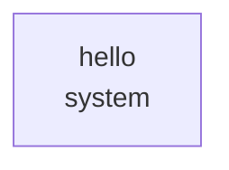
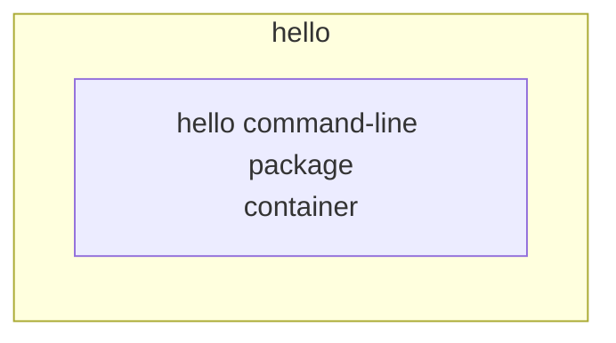
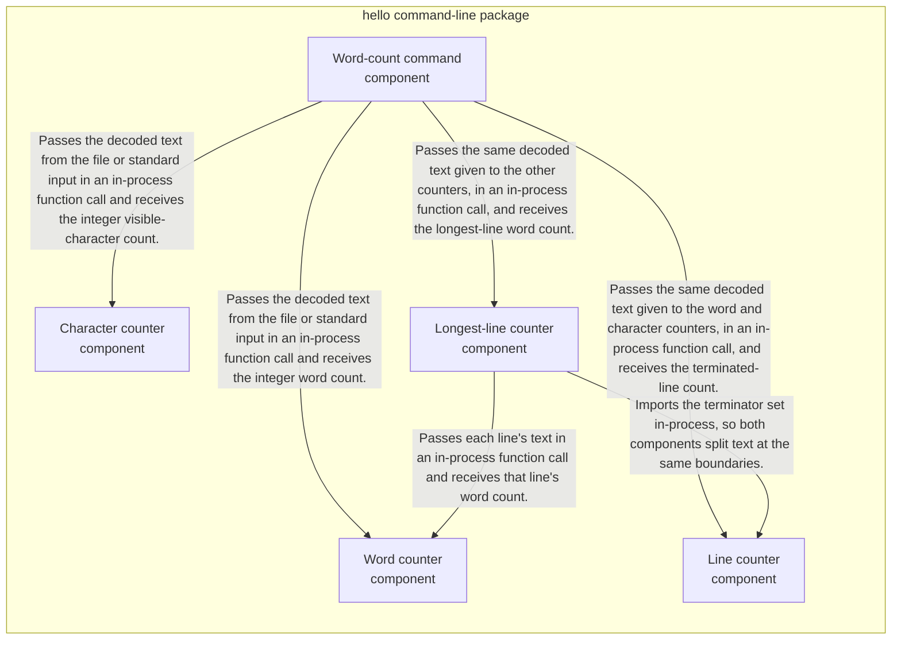

# ARCHITECTURE.md

## 1. System Mission

(none yet)

## 2. Business Goals

(none yet)

## 3. Architectural Drivers

(none yet)

## 4. Architectural Style

(none yet)

## 5. Quality Attribute Scenarios

(none yet)

## 6. Tactics

(none yet)

## 7. Architectural Patterns

(none yet)

## 8. System Decomposition

### Context

### Container

### Component: hello command-line package

| ID | Unit | Level | Parent | Owns | Does NOT own | Deployment | Tech Family |
|----|------|-------|--------|------|--------------|------------|-------------|
| hello | hello | system |  | Giving users local, dependency-free text utilities. It currently reports the word count, the non-whitespace character count, the terminated-line count and the longest-line word count of one input in a single invocation. The input is one text file or standard input. | Other text statistics beyond word, character, line and longest-line word counts, such as bytes, the position or text of the longest line, or per-line output. Several inputs in one invocation, totals, implicit or auto-detected stdin, non-UTF-8 encodings, or distribution through a public package index. | Installed from the repository into a local Python environment on the user's machine. | Python (current stable release), standard library only |
| hello-cli | hello command-line package | container | hello | The installable src-layout hello package and its console command. The command takes one file path, or the '-' argument for standard input. It prints that input's word, character, line and longest-line word counts on one line and exits with a status code. | Any network access, persistent state, configuration files, or third-party runtime dependencies. Command-line flags or arguments beyond the single PATH or '-' argument. Reading standard input when no argument is given. | Run as a local process on the user's machine after installing the package from the repository into the project environment. | Python standard library; console entry point declared in pyproject.toml; environment managed with the existing lockfile tooling |
| word-count-command | Word-count command | component | hello-cli | Parsing the single argument: a file path, or '-' for standard input. It reads the chosen source once and decodes it as UTF-8 along one shared path. It passes that same decoded text to the word, character, line and longest-line counters. It prints the four counts as one line in the form `words: <N> characters: <M> lines: <L> longest_line_words: <K>`. It turns a missing file, an unreadable file or undecodable content into a one-line stderr message, a non-zero exit status and empty stdout. Messages for standard input name `<stdin>`, and file-path messages and statuses are unchanged. | The definition of what a word, a visible character, a line or the longest line is, or counting logic of any kind. It does not decode text a second time, along a separate path per source, or with newline translation. It does not read standard input when no argument is given. A file literally named '-' is reached only through './-'. |  | Python standard library |
| word-counter | Word counter | component | hello-cli | The word rule: a word is a run of non-whitespace characters separated by whitespace. It counts the words in a given text and returns the number. | File access, encoding, argument handling, output or exit codes; it never touches the filesystem or the process. |  | Python standard library |
| character-counter | Character counter | component | hello-cli | The character rule: a visible character is a non-whitespace character, using the same whitespace definition as the word rule, and a base character followed by combining marks counts once. It counts the visible characters in a given text and returns the number. | The definition of a word, file access, encoding, argument handling, output formatting or exit codes; it never touches the filesystem or the process, and it counts neither bytes nor raw code points. |  | Python standard library |
| line-counter | Line counter | component | hello-cli | The line rule. A line is a segment of text ended by a line terminator, and a final segment with no terminator is not counted. The terminator set is exactly the boundaries str.splitlines() recognises, listed explicitly so the rule does not depend on library behaviour: LF (U+000A), CR (U+000D), the CRLF pair (U+000D U+000A, counted as one terminator), VT (U+000B), FF (U+000C), FS (U+001C), GS (U+001D), RS (U+001E), NEL (U+0085), LS (U+2028) and PS (U+2029). It counts the terminated lines in a given text and returns the number. | The definition of a word or a visible character, file access, encoding or newline translation, argument handling, output formatting or exit codes. It never touches the filesystem or the process, and it does not follow the LF-only wc -l convention. |  | Python standard library |
| longest-line-counter | Longest-line counter | component | hello-cli | The longest-line rule. It splits text into lines at the existing terminator set, with CRLF as one terminator. An unterminated final segment counts as a line for this measure only. It counts the words in each line with the word counter and returns the highest count. It returns 0 when no line has a word. | The definition of a word or of the terminator set. The terminated-line count, where an unterminated final segment stays uncounted. File access, encoding, argument handling, output formatting or exit codes. It never touches the filesystem or the process. It reports neither the position nor the text of the longest line. |  | Python standard library |

## 9. Communication Patterns

| From | To | Description |
|------|----|-------------|
| word-count-command | word-counter | Passes the decoded text from the file or standard input in an in-process function call and receives the integer word count. |
| word-count-command | character-counter | Passes the decoded text from the file or standard input in an in-process function call and receives the integer visible-character count. |
| word-count-command | line-counter | Passes the same decoded text given to the word and character counters, in an in-process function call, and receives the terminated-line count. |
| word-count-command | longest-line-counter | Passes the same decoded text given to the other counters, in an in-process function call, and receives the longest-line word count. |
| longest-line-counter | word-counter | Passes each line's text in an in-process function call and receives that line's word count. |
| longest-line-counter | line-counter | Imports the terminator set in-process, so both components split text at the same boundaries. |

## 10. Data Architecture

(none yet)

## 11. Cross-cutting Concerns

(none yet)

## 12. Deployment Topology

(none yet)

## 13. Global Anti-Patterns

(none yet)

## 14. Open Architectural Risks

(none yet)

## 15. Architecture Decision Index

(none yet)

## 16. Related Artifacts

(none yet)

## Changelog

| Version | Date | Summary | Triggered by |
|---------|------|---------|--------------|
| 1.0 | 2026-11-12 | First architecture draft: the hello system as one local Python CLI container with a word-count command, split into a command-line shell and a pure, dependency-free counting core. | SPEC-0001 |
| 1.1 | 2026-11-14 | Add a pure character-counter component beside the word counter, and have the command print both counts on one line (a deliberate break from SPEC-0001's bare integer), so users get words and non-whitespace characters in one invocation. | SPEC-0002 |
| 1.2 | 2026-11-14 | Add a pure line-counter component beside the word and character counters, and have the command append ` lines: <L>` to its single success line, so users get words, characters and lines from one invocation (SPEC-0003, from STRAT-0003). | SPEC-0003 |
| 1.3 | 2026-11-20 | Let wordcount read standard input through an explicit '-' argument, sharing the single decode and counting path with files (STRAT-0004). | SPEC-0004 |
| 1.4 | 2026-11-27 | Add a longest-line-counter component and print its word figure as a trailing `longest_line_words: <N>` field, reusing the word rule and terminator set (STRAT-0006). | SPEC-0006 |
