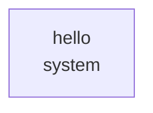
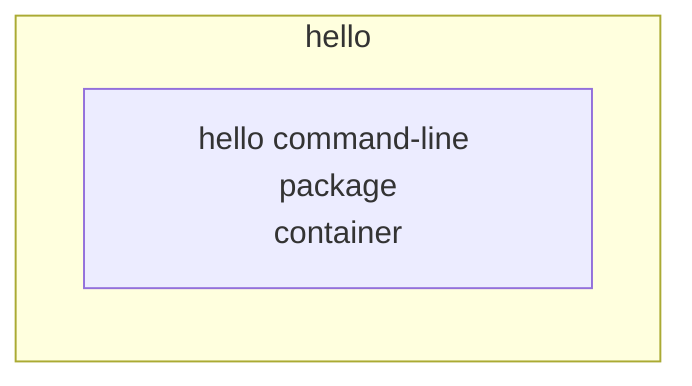
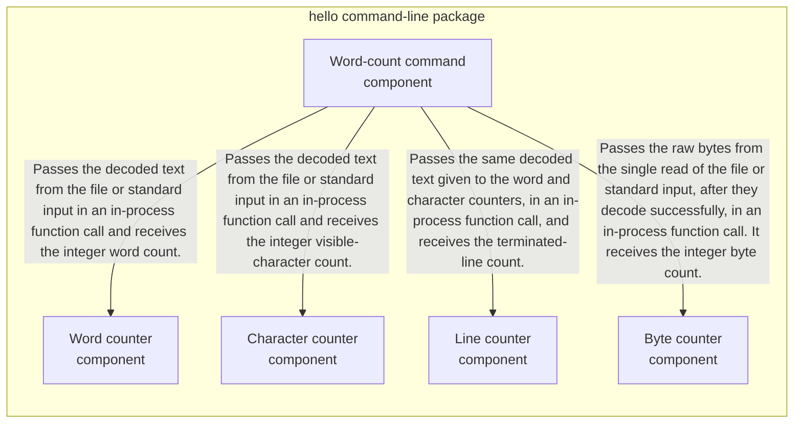

# ARCHITECTURE.md

## 1. System Mission

(none yet)

## 2. Business Goals

(none yet)

## 3. Architectural Drivers

(none yet)

## 4. Architectural Style

(none yet)

## 5. Quality Attribute Scenarios

(none yet)

## 6. Tactics

(none yet)

## 7. Architectural Patterns

(none yet)

## 8. System Decomposition

### Context

### Container

### Component: hello command-line package

| ID | Unit | Level | Parent | Owns | Does NOT own | Deployment | Tech Family |
|----|------|-------|--------|------|--------------|------------|-------------|
| hello | hello | system |  | Giving users local, dependency-free text utilities. It currently reports the word count, the non-whitespace character count, the raw byte count and the terminated-line count of one input in a single invocation. The input is one text file or standard input. | Other text statistics beyond word, character, byte and line counts, such as longest line or per-line output. Byte counts for input that is not valid UTF-8. Several inputs in one invocation, totals, implicit or auto-detected stdin, non-UTF-8 encodings, or distribution through a public package index. | Installed from the repository into a local Python environment on the user's machine. | Python (current stable release), standard library only |
| hello-cli | hello command-line package | container | hello | The installable src-layout hello package and its console command. The command takes one file path, or the '-' argument for standard input. It prints that input's word, character, byte and line counts on one line and exits with a status code. | Any network access, persistent state, configuration files, or third-party runtime dependencies. Command-line flags or arguments beyond the single PATH or '-' argument. Reading standard input when no argument is given. | Run as a local process on the user's machine after installing the package from the repository into the project environment. | Python standard library; console entry point declared in pyproject.toml; environment managed with the existing lockfile tooling |
| word-count-command | Word-count command | component | hello-cli | Parsing the single argument: a file path, or '-' for standard input. It reads the chosen source once as raw bytes and decodes them as UTF-8 along one shared path. It passes those same raw bytes to the byte counter. It passes the decoded text to the word, character and line counters. It prints the four counts as one line in the form `words: <N> characters: <M> bytes: <B> lines: <L>`. It turns a missing file, an unreadable file or undecodable content into a one-line stderr message, a non-zero exit status and empty stdout, with no byte count. Messages for standard input name `<stdin>`, and file-path messages and statuses are unchanged. | The definition of what a word, a visible character, a byte count or a line is, or counting logic of any kind. It does not read the input a second time, take the size from the file system, or re-encode decoded text. It does not decode text a second time, along a separate path per source, or with newline translation. It does not read standard input when no argument is given. A file literally named '-' is reached only through './-'. |  | Python standard library |
| word-counter | Word counter | component | hello-cli | The word rule: a word is a run of non-whitespace characters separated by whitespace. It counts the words in a given text and returns the number. | File access, encoding, argument handling, output or exit codes; it never touches the filesystem or the process. |  | Python standard library |
| character-counter | Character counter | component | hello-cli | The character rule: a visible character is a non-whitespace character, using the same whitespace definition as the word rule, and a base character followed by combining marks counts once. It counts the visible characters in a given text and returns the number. | The definition of a word, file access, encoding, argument handling, output formatting or exit codes; it never touches the filesystem or the process, and it counts neither bytes nor raw code points. |  | Python standard library |
| line-counter | Line counter | component | hello-cli | The line rule. A line is a segment of text ended by a line terminator, and a final segment with no terminator is not counted. The terminator set is exactly the boundaries str.splitlines() recognises, listed explicitly so the rule does not depend on library behaviour: LF (U+000A), CR (U+000D), the CRLF pair (U+000D U+000A, counted as one terminator), VT (U+000B), FF (U+000C), FS (U+001C), GS (U+001D), RS (U+001E), NEL (U+0085), LS (U+2028) and PS (U+2029). It counts the terminated lines in a given text and returns the number. | The definition of a word or a visible character, file access, encoding or newline translation, argument handling, output formatting or exit codes. It never touches the filesystem or the process, and it does not follow the LF-only wc -l convention. |  | Python standard library |
| byte-counter | Byte counter | component | hello-cli | The byte rule: the byte count is the number of raw bytes in the input as read, before any decoding. It counts the bytes it is given and returns the number. | Reading the input, decoding, or deriving bytes from decoded text. It does not own the word, character or line rules, argument handling, output formatting or exit codes. It never touches the filesystem or the process. |  | Python standard library |

## 9. Communication Patterns

| From | To | Description |
|------|----|-------------|
| word-count-command | word-counter | Passes the decoded text from the file or standard input in an in-process function call and receives the integer word count. |
| word-count-command | character-counter | Passes the decoded text from the file or standard input in an in-process function call and receives the integer visible-character count. |
| word-count-command | line-counter | Passes the same decoded text given to the word and character counters, in an in-process function call, and receives the terminated-line count. |
| word-count-command | byte-counter | Passes the raw bytes from the single read of the file or standard input, after they decode successfully, in an in-process function call. It receives the integer byte count. |

## 10. Data Architecture

(none yet)

## 11. Cross-cutting Concerns

(none yet)

## 12. Deployment Topology

(none yet)

## 13. Global Anti-Patterns

(none yet)

## 14. Open Architectural Risks

(none yet)

## 15. Architecture Decision Index

(none yet)

## 16. Related Artifacts

(none yet)

## Changelog

| Version | Date | Summary | Triggered by |
|---------|------|---------|--------------|
| 1.0 | 2026-11-12 | First architecture draft: the hello system as one local Python CLI container with a word-count command, split into a command-line shell and a pure, dependency-free counting core. | SPEC-0001 |
| 1.1 | 2026-11-14 | Add a pure character-counter component beside the word counter, and have the command print both counts on one line (a deliberate break from SPEC-0001's bare integer), so users get words and non-whitespace characters in one invocation. | SPEC-0002 |
| 1.2 | 2026-11-14 | Add a pure line-counter component beside the word and character counters, and have the command append ` lines: <L>` to its single success line, so users get words, characters and lines from one invocation (SPEC-0003, from STRAT-0003). | SPEC-0003 |
| 1.3 | 2026-11-20 | Let wordcount read standard input through an explicit '-' argument, sharing the single decode and counting path with files (STRAT-0004). | SPEC-0004 |
| 1.4 | 2026-11-23 | Add a pure byte-counter fed the raw input bytes from the single read, and print a four-field success line, so users get byte size beside characters (STRAT-0005). | SPEC-0005 |
