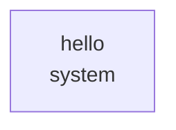
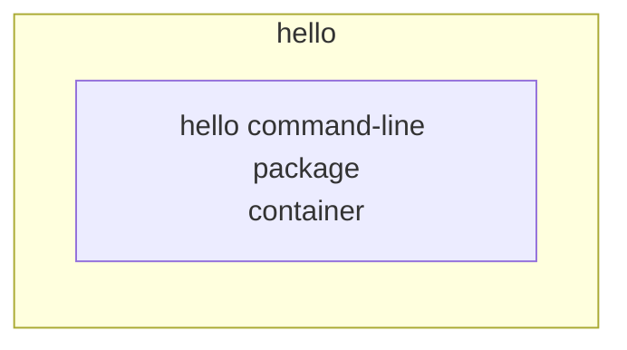
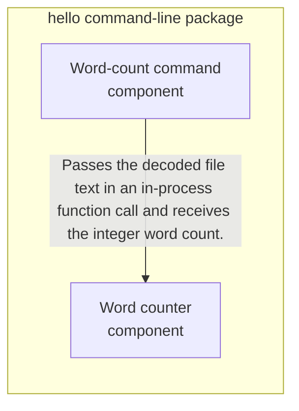

# ARCHITECTURE.md

## 1. System Mission

(none yet)

## 2. Business Goals

(none yet)

## 3. Architectural Drivers

(none yet)

## 4. Architectural Style

(none yet)

## 5. Quality Attribute Scenarios

(none yet)

## 6. Tactics

(none yet)

## 7. Architectural Patterns

(none yet)

## 8. System Decomposition

### Context

### Container

### Component: hello command-line package

| ID | Unit | Level | Parent | Owns | Does NOT own | Deployment | Tech Family |
|----|------|-------|--------|------|--------------|------------|-------------|
| hello | hello | system |  | Giving users local, dependency-free text utilities, starting with reporting the word count of one text file. | Other text statistics, batch or stdin processing, non-UTF-8 encodings, or distribution through a public package index. | Installed from the repository into a local Python environment on the user's machine. | Python (current stable release), standard library only |
| hello-cli | hello command-line package | container | hello | The installable src-layout hello package and its console command that takes one file path, prints that file's word count, and exits with a status code. | Any network access, persistent state, configuration files, or third-party runtime dependencies. | Run as a local process on the user's machine after installing the package from the repository into the project environment. | Python standard library; console entry point declared in pyproject.toml; environment managed with the existing lockfile tooling |
| word-count-command | Word-count command | component | hello-cli | Parsing the single file-path argument, reading the file as UTF-8 text, passing the text to the counter, printing the count, and turning a missing file, unreadable file or undecodable content into a one-line message on standard error with a non-zero exit status. | The definition of what a word is, or counting logic of any kind. |  | Python standard library |
| word-counter | Word counter | component | hello-cli | The word rule: a word is a run of non-whitespace characters separated by whitespace. It counts the words in a given text and returns the number. | File access, encoding, argument handling, output or exit codes; it never touches the filesystem or the process. |  | Python standard library |

## 9. Communication Patterns

| From | To | Description |
|------|----|-------------|
| word-count-command | word-counter | Passes the decoded file text in an in-process function call and receives the integer word count. |

## 10. Data Architecture

(none yet)

## 11. Cross-cutting Concerns

(none yet)

## 12. Deployment Topology

(none yet)

## 13. Global Anti-Patterns

(none yet)

## 14. Open Architectural Risks

(none yet)

## 15. Architecture Decision Index

(none yet)

## 16. Related Artifacts

(none yet)

## Changelog

| Version | Date | Summary | Triggered by |
|---------|------|---------|--------------|
| 1.0 | 2026-11-12 | First architecture draft: the hello system as one local Python CLI container with a word-count command, split into a command-line shell and a pure, dependency-free counting core. | SPEC-0001 |
