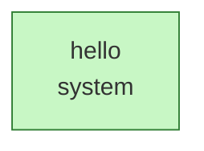
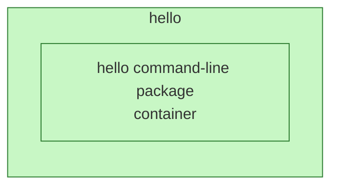
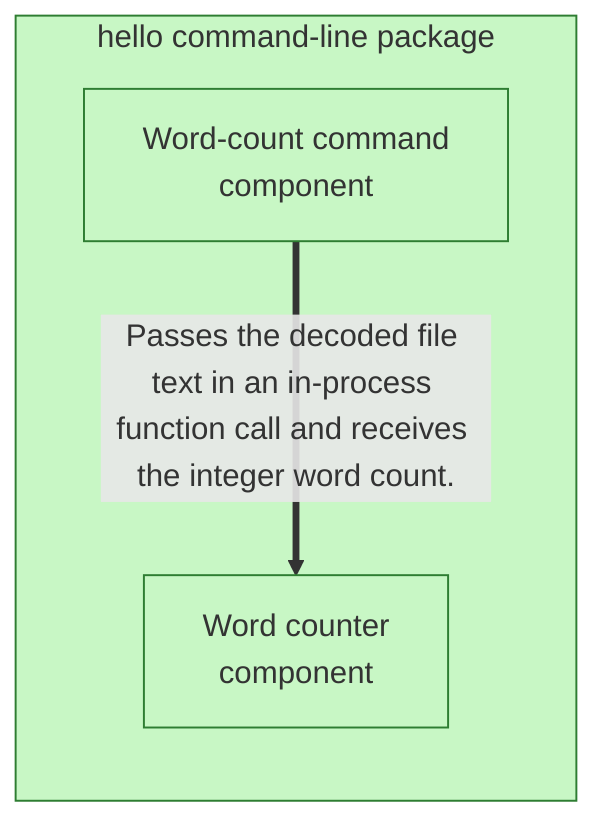

# Feature: Word-count command

## Blueprint

### Context

The hello project has no user-facing capability yet: a user who wants to know how many words a text file contains has nothing to run and must count by hand or find another tool. The README gives no install or run path, and the AGENTS.md Toolchain table is empty, so no quality bar is enforced on changes.

This spec adds a single `wordcount PATH` console command to the existing src-layout hello package, built on the standard library only. A pure word counter defines a word as a run of non-whitespace characters; a thin command layer reads the file as UTF-8, prints the count, and turns missing, unreadable or undecodable files into a one-line error with a non-zero exit. It also records four Quality Gate commands (format, lint, type-check, test) in AGENTS.md, pins the project to the Python version in .python-version, and documents installation and use in the README.

### Feature Contract

- **C4 model elements involved:** hello, hello-cli, word-count-command, word-counter
- **API Contracts:** Console command: `wordcount PATH` — exactly one positional argument; prints `<int>\n` to stdout and exits 0 on success, Error contract: missing file -> stderr `wordcount: error: file not found: PATH`, exit 1; unreadable path -> stderr `wordcount: error: cannot read file: PATH`, exit 1; invalid UTF-8 -> stderr `wordcount: error: file is not valid UTF-8 text: PATH`, exit 1; wrong argument count -> argparse usage on stderr, exit 2, Python API: hello.counter.count_words(text: str) -> int, Python API: hello.cli.main(argv: list[str] | None = None) -> int, pyproject.toml [project.scripts]: wordcount = "hello.cli:main"
- **Data Models:** Input: file contents read as str via open(path, encoding="utf-8") with strict error handling, Output: a single non-negative integer word count
- **Dependencies:** depends on Python runtime at the version recorded in .python-version (existing), Existing src-layout hello package, pyproject.toml and uv.lock (existing), Python standard library: argparse, sys (runtime), Dev-only tools in the `dev` dependency group: ruff (format and lint), mypy (type-check), pytest (tests); needed by Future hello text utilities reusing the CLI error contract (none planned)
- **Constraints:** No third-party runtime dependencies: [project].dependencies stays empty, hello.counter performs no file, process or console I/O, Input is decoded as strict UTF-8; other encodings are out of scope, One file path per invocation; no stdin, multiple files or directories, Every error case produces exactly one stderr line and no traceback, Every dev tool added has its rationale recorded in this spec or an ADR, per AGENTS.md
- **ADRs:** ADR-0001, ADR-0002, ADR-0003, ADR-0004
- **Critical components:** (none)

## Architecture changes

**Summary:** First architecture draft: the hello system as one local Python CLI container with a word-count command, split into a command-line shell and a pure, dependency-free counting core.

### Elements added

| ID | Unit | Level | Parent | Owns | Does NOT own | Deployment | Tech Family |
|----|------|-------|--------|------|--------------|------------|-------------|
| hello | hello | system |  | Giving users local, dependency-free text utilities, starting with reporting the word count of one text file. | Other text statistics, batch or stdin processing, non-UTF-8 encodings, or distribution through a public package index. | Installed from the repository into a local Python environment on the user's machine. | Python (current stable release), standard library only |
| hello-cli | hello command-line package | container | hello | The installable src-layout hello package and its console command that takes one file path, prints that file's word count, and exits with a status code. | Any network access, persistent state, configuration files, or third-party runtime dependencies. | Run as a local process on the user's machine after installing the package from the repository into the project environment. | Python standard library; console entry point declared in pyproject.toml; environment managed with the existing lockfile tooling |
| word-count-command | Word-count command | component | hello-cli | Parsing the single file-path argument, reading the file as UTF-8 text, passing the text to the counter, printing the count, and turning a missing file, unreadable file or undecodable content into a one-line message on standard error with a non-zero exit status. | The definition of what a word is, or counting logic of any kind. |  | Python standard library |
| word-counter | Word counter | component | hello-cli | The word rule: a word is a run of non-whitespace characters separated by whitespace. It counts the words in a given text and returns the number. | File access, encoding, argument handling, output or exit codes; it never touches the filesystem or the process. |  | Python standard library |

### Relations added

| From | To | Description |
|------|----|-------------|
| word-count-command | word-counter | Passes the decoded file text in an in-process function call and receives the integer word count. |

### Diagrams

#### Context



#### Container



#### Component: hello command-line package



## Contract

### Definition of Done

- [ ] src/hello/counter.py defines count_words(text: str) -> int, which returns the number of runs of non-whitespace characters separated by whitespace (equivalent to len(text.split())).
- [ ] count_words returns 0 for an empty string and for a string containing only whitespace.
- [ ] src/hello/cli.py defines main(argv: list[str] | None = None) -> int, which parses exactly one positional PATH argument with argparse.
- [ ] pyproject.toml declares the console script `wordcount = "hello.cli:main"` under [project.scripts].
- [ ] Running `wordcount PATH` on a readable UTF-8 file prints only the integer word count followed by a newline to stdout and exits with status 0.
- [ ] Tabs, newlines and repeated spaces act only as separators: a file containing "  alpha\t\tbeta\n\ngamma  " reports 3.
- [ ] Punctuation attached to non-whitespace characters is part of a word: a file containing "Hello, world! It's-fine." reports 3.
- [ ] UTF-8 files with non-ASCII characters are counted: a file containing "café naïve 日本" reports 3.
- [ ] An empty file reports 0 and exits with status 0.
- [ ] A path that does not exist prints exactly one line `wordcount: error: file not found: PATH` to stderr, prints nothing to stdout, and exits with status 1.
- [ ] A path that exists but cannot be read (a directory, or a file without read permission) prints exactly one line starting with `wordcount: error: cannot read file:` to stderr and exits with status 1.
- [ ] A file whose bytes are not valid UTF-8 prints exactly one line `wordcount: error: file is not valid UTF-8 text: PATH` to stderr and exits with status 1.
- [ ] No error case writes a Python traceback to stderr.
- [ ] Invoking `wordcount` with no argument or with more than one argument prints argparse usage to stderr and exits with status 2.
- [ ] pyproject.toml [project].dependencies is empty; ruff, mypy and pytest are declared only in the `dev` dependency group.
- [ ] pyproject.toml requires-python has a lower bound equal to the major.minor version recorded in .python-version.
- [ ] The AGENTS.md Toolchain table lists four Quality Gate rows: format (`uv run ruff format --check .`), lint (`uv run ruff check .`), type-check (`uv run mypy --strict src tests`) and test (`uv run pytest`).
- [ ] All four Quality Gate commands exit 0 on the finished change.
- [ ] README.md documents the install step (`uv sync`), the run step (`uv run wordcount PATH`), the word rule, and the error exit statuses.

### Regression Guardrails

- `import hello` still succeeds and src/hello/__init__.py keeps every name it exported before this change.
- src/hello/py.typed remains present in the package, so the package stays marked as typed.
- The src layout is unchanged: package code stays under src/hello/.
- uv.lock stays consistent with pyproject.toml: `uv lock --check` exits 0 after the change.
- The existing AGENTS.md Judgment Boundaries bullets are kept word for word; only the Toolchain table is filled in.
- The word counter keeps the existing architecture boundary: hello.counter performs no file, process or console I/O.

### Scenarios

```gherkin
Scenario: count_words counts whitespace-separated runs
  Given  the hello.counter module is importable
  When  count_words is called with the string "one two three"
  Then  it returns the integer 3

Scenario: count_words returns zero for empty and whitespace-only text
  Given  the hello.counter module is importable
  When  count_words is called with "" and then with " \t\n "
  Then  both calls return 0

Scenario: wordcount prints the count of a simple file
  Given  a temporary file notes.txt containing "one two three\n" encoded as UTF-8
  When  main(["<path to notes.txt>"]) is called with stdout and stderr captured
  Then  the return value is 0
  And  stdout is exactly "3\n"
  And  stderr is empty

Scenario: whitespace variants act only as separators
  Given  a temporary file containing "  alpha\t\tbeta\n\ngamma  " encoded as UTF-8
  When  main is called with that file's path
  Then  the return value is 0
  And  stdout is exactly "3\n"

Scenario: punctuation stays part of a word
  Given  a temporary file containing "Hello, world! It's-fine." encoded as UTF-8
  When  main is called with that file's path
  Then  the return value is 0
  And  stdout is exactly "3\n"

Scenario: non-ASCII UTF-8 text is counted
  Given  a temporary file containing "café naïve 日本" encoded as UTF-8
  When  main is called with that file's path
  Then  the return value is 0
  And  stdout is exactly "3\n"

Scenario: empty file reports zero
  Given  a temporary file with zero bytes
  When  main is called with that file's path
  Then  the return value is 0
  And  stdout is exactly "0\n"

Scenario: missing file fails with a one-line message
  Given  a path notse.txt inside a temporary directory where no such file exists
  When  main is called with that path
  Then  the return value is 1
  And  stdout is empty
  And  stderr is exactly one line "wordcount: error: file not found: <path>"
  And  stderr does not contain "Traceback"

Scenario: directory path fails as unreadable
  Given  a temporary directory path
  When  main is called with the directory path
  Then  the return value is 1
  And  stderr is exactly one line starting with "wordcount: error: cannot read file:"
  And  stderr does not contain "Traceback"

Scenario: file without read permission fails as unreadable
  Given  a POSIX system where the test is not running as root
  And  a temporary file whose mode is set to 000
  When  main is called with that file's path
  Then  the return value is 1
  And  stderr is exactly one line starting with "wordcount: error: cannot read file:"

Scenario: undecodable content fails with a one-line message
  Given  a temporary file containing the bytes b"\xff\xfe\xfa"
  When  main is called with that file's path
  Then  the return value is 1
  And  stdout is empty
  And  stderr is exactly one line "wordcount: error: file is not valid UTF-8 text: <path>"

Scenario: missing argument is a usage error
  Given  no arguments
  When  main([]) is called with stderr captured
  Then  SystemExit is raised with code 2
  And  stderr contains "usage:"

Scenario: too many arguments is a usage error
  Given  two existing temporary text files a.txt and b.txt
  When  main is called with both paths
  Then  SystemExit is raised with code 2
  And  stderr contains "usage:"

Scenario: console script is installed and runs
  Given  the project environment synced with `uv sync`
  And  a temporary file containing "one two three" encoded as UTF-8
  When  the subprocess `uv run wordcount <path>` is run
  Then  its exit status is 0
  And  its stdout is exactly "3\n"

Scenario: requires-python matches .python-version
  Given  pyproject.toml and .python-version at the repository root
  When  the test tests/test_project_config.py::test_requires_python_matches_python_version_file runs
  Then  it passes

Scenario: README documents install, run, word rule and errors
  Given  README.md at the repository root
  When  the test tests/test_readme.py::test_readme_documents_install_run_and_word_rule runs
  Then  it passes, confirming README.md contains "uv sync", "uv run wordcount", the sentence defining a word as a run of non-whitespace characters, and the exit statuses 1 and 2

Scenario: no third-party runtime dependencies
  Given  pyproject.toml at the repository root
  When  the test tests/arch/test_dependencies.py::test_no_runtime_dependencies runs
  Then  it passes

Scenario: word counter performs no I/O
  Given  src/hello/counter.py
  When  the test tests/arch/test_layering.py::test_word_counter_has_no_io_imports runs
  Then  it passes

Scenario: Quality Gate commands are recorded in AGENTS.md
  Given  AGENTS.md at the repository root
  When  the test tests/test_agents_md.py::test_toolchain_lists_quality_gate_commands runs
  Then  it passes

Scenario: error output is a single line without traceback
  Given  the missing-file, directory and undecodable-file cases
  When  the test tests/test_cli.py::test_errors_are_single_line_without_traceback runs
  Then  it passes

Scenario: guardrail: existing hello package import is unchanged
  Given  the names exported by src/hello/__init__.py before this change are recorded in the test
  When  the test tests/test_package.py::test_existing_package_surface_unchanged runs
  Then  it passes, confirming `import hello` succeeds and every recorded name is still present

Scenario: guardrail: py.typed marker is still shipped
  Given  the project environment synced with `uv sync`
  When  importlib.resources.files("hello") is checked for "py.typed"
  Then  py.typed exists in the installed package

Scenario: guardrail: lockfile stays consistent
  Given  the change applied to pyproject.toml and uv.lock
  When  `uv lock --check` is run
  Then  it exits with status 0

Scenario: guardrail: AGENTS.md judgment boundaries are preserved
  Given  AGENTS.md after the change
  When  the test tests/test_agents_md.py::test_judgment_boundaries_preserved runs
  Then  it passes, confirming both existing Judgment Boundaries bullets are present word for word
```

## Changelog

| Version | Date | Summary | Triggered by |
|---------|------|---------|--------------|

## Sign-Off

**Authored by:** openrouter:anthropic/claude-opus-5.5  
**Reviewed by:** _(pending)_ — _(pending)_

**Ready for PBI_PLANNING:** [ ] Yes [ ] No
