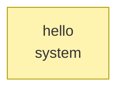
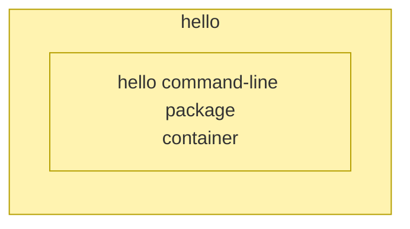
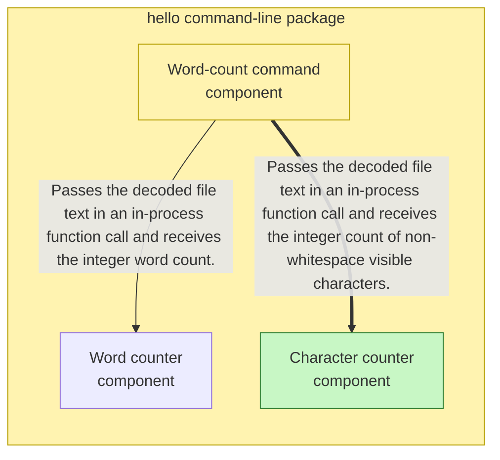

# Feature: Character count in word-count output

## Blueprint

### Context

The wordcount command currently reports only the word count of one UTF-8 text file, as a bare integer. Users also need the number of visible characters in the same invocation, with no flags and no second command.

This spec makes every successful invocation print both measures on one labeled line. It deliberately supersedes SPEC-0001's bare-integer success output, while keeping the invocation, the word rule and the one-line error contract unchanged.

### Feature Contract

- **C4 model elements involved:**
  - hello
  - hello-cli
  - word-count-command
  - word-counter
  - character-counter
- **API Contracts:**
  - Console command: `wordcount PATH`, one positional argument, no new flags; entry point hello.cli:main(argv: list[str] | None = None) -> int is unchanged.
  - Success output on stdout: exactly `words: <N> characters: <M>` followed by a newline, exit status 0. This replaces SPEC-0001's bare-integer output.
  - Error output and exit statuses (1 for runtime errors, 2 for usage errors) are unchanged from SPEC-0001 and ADR-0004.
  - New function hello.characters.count_characters(text: str) -> int, a pure function; hello.counter.count_words(text: str) -> int is unchanged.
- **Data Models:**
  - Input: the decoded UTF-8 text of one file as str.
  - Output: two non-negative integers, the word count and the visible-character count, rendered in one stdout line.
  - Visible character: a code point that is not whitespace (str.isspace() false) and whose unicodedata.category does not start with 'M' (Mn, Mc, Me); combining marks therefore never add to the count.
- **Dependencies:**
  - Depends on:
    - hello.counter.count_words (existing, SPEC-0001)
    - Python standard library unicodedata module (no third-party dependency, per ADR-0001)
    - SPEC-0001 (existing): this spec supersedes only its bare-integer successful-output requirement and retains its other requirements
    - Quality Gate toolchain from ADR-0003 (existing)
  - Needed by:
    - Documentation and tests of the changed success-output contract
    - Any consumer of wordcount output, which must now parse the labeled line instead of a bare integer
- **Constraints:**
  - No new command-line flags, no compatibility mode and no separate invocation; every successful invocation prints both counts.
  - hello.characters performs no file, process or console I/O; all I/O stays in hello.cli (ADR-0002).
  - The character count is neither a byte count nor a raw code-point count; it uses the same whitespace definition as the word rule (str.isspace()).
  - No third-party runtime dependencies; [project].dependencies stays empty (ADR-0001).
  - Runtime errors keep the one-line stderr form and exit status 1, with no traceback (ADR-0004).
- **ADRs:**
  - ADR-0001
  - ADR-0002
  - ADR-0003
  - ADR-0004
  - ADR-0005
  - ADR-0006
- **Critical components:** (none)

## Architecture changes

**Summary:** Add a pure character-counter component beside the word counter, and have the command print both counts on one line (a deliberate break from SPEC-0001's bare integer), so users get words and non-whitespace characters in one invocation.

### Elements added

| ID | Unit | Level | Parent | Owns | Does NOT own | Deployment | Tech Family |
|----|------|-------|--------|------|--------------|------------|-------------|
| character-counter | Character counter | component | hello-cli | The character rule: a visible character is a non-whitespace character, using the same whitespace definition as the word rule, and a base character followed by combining marks counts once. It counts the visible characters in a given text and returns the number. | The definition of a word, file access, encoding, argument handling, output formatting or exit codes; it never touches the filesystem or the process, and it counts neither bytes nor raw code points. |  | Python standard library |

### Elements changed

| ID | Unit | Level | Parent | Owns | Does NOT own | Deployment | Tech Family |
|----|------|-------|--------|------|--------------|------------|-------------|
| hello | hello | system |  | Giving users local, dependency-free text utilities, currently reporting the word count and the non-whitespace character count of one text file in a single invocation. | Other text statistics beyond word and character counts, batch or stdin processing, non-UTF-8 encodings, or distribution through a public package index. | Installed from the repository into a local Python environment on the user's machine. | Python (current stable release), standard library only |
| hello-cli | hello command-line package | container | hello | The installable src-layout hello package and its console command that takes one file path, prints that file's word count and character count on one line, and exits with a status code. | Any network access, persistent state, configuration files, or third-party runtime dependencies. | Run as a local process on the user's machine after installing the package from the repository into the project environment. | Python standard library; console entry point declared in pyproject.toml; environment managed with the existing lockfile tooling |
| word-count-command | Word-count command | component | hello-cli | Parsing the single file-path argument, reading the file as UTF-8 text, passing the text to the word counter and the character counter, printing both counts as one line in the form `words: <N> characters: <M>`, and turning a missing file, unreadable file or undecodable content into a one-line message on standard error with a non-zero exit status and no counts on standard output. | The definition of what a word or a visible character is, or counting logic of any kind. |  | Python standard library |

### Relations added

| From | To | Description |
|------|----|-------------|
| word-count-command | character-counter | Passes the decoded file text in an in-process function call and receives the integer count of non-whitespace visible characters. |

### Diagrams

#### Context



#### Container



#### Component: hello command-line package



## Contract

### Definition of Done

- [ ] src/hello/characters.py defines count_characters(text: str) -> int, which returns the number of characters in text that are not whitespace (str.isspace() is false) and whose unicodedata category does not start with 'M'.
- [ ] count_characters returns 0 for an empty string and for a string containing only whitespace.
- [ ] count_characters counts the precomposed string 'é' (U+00E9) as 1 and the decomposed string 'e' followed by U+0301 as 1.
- [ ] hello.characters performs no file, process or console I/O and imports only the standard library.
- [ ] Running `wordcount PATH` on a readable UTF-8 file prints exactly one line of the form `words: <N> characters: <M>` followed by a newline to stdout, nothing to stderr, and exits with status 0.
- [ ] For a file containing 'café', `wordcount PATH` prints `words: 1 characters: 4`.
- [ ] For an empty file and for a whitespace-only file, `wordcount PATH` prints `words: 0 characters: 0` and exits with status 0.
- [ ] hello.cli.main obtains <N> from hello.counter.count_words and <M> from hello.characters.count_characters on the same decoded text.
- [ ] README.md documents the `words: <N> characters: <M>` output line, the visible-character rule, and states that the bare-integer output of the earlier version no longer applies.
- [ ] All four Quality Gate commands exit 0 on the finished change.

### Regression Guardrails

- The `wordcount PATH` invocation is unchanged: one positional PATH argument, no new flags, and the console script `wordcount = "hello.cli:main"` remains declared in pyproject.toml.
- The word count <N> in the output follows the unchanged SPEC-0001 word rule: a file containing '  alpha\t\tbeta\n\ngamma  ' reports 3 words.
- hello.counter.count_words returns the same values as before and still performs no file, process or console I/O.
- A path that does not exist still prints exactly one line `wordcount: error: file not found: PATH` to stderr, prints nothing to stdout, and exits with status 1.
- A path that exists but cannot be read (a directory or a file without read permission) still prints exactly one line starting with `wordcount: error: cannot read file:` to stderr, prints nothing to stdout, and exits with status 1.
- A file whose bytes are not valid UTF-8 still prints exactly one line `wordcount: error: file is not valid UTF-8 text: PATH` to stderr, prints nothing to stdout, and exits with status 1.
- No error case writes a Python traceback to stderr, and invoking `wordcount` with no argument or with more than one argument still prints argparse usage to stderr and exits with status 2.
- `import hello` still succeeds with every name src/hello/__init__.py exported before, src/hello/py.typed remains present, and the src layout is unchanged.
- pyproject.toml [project].dependencies stays empty, and ruff, mypy and pytest stay declared only in the `dev` dependency group.
- The AGENTS.md Toolchain table keeps its four Quality Gate rows and its Judgment Boundaries bullets word for word.

### Scenarios

```gherkin
Scenario: count_characters excludes whitespace
  Given  the text 'a b\tc\n' containing three non-whitespace characters separated by a space, a tab and a newline
  When  hello.characters.count_characters is called with that text
  Then  the returned value is 3

Scenario: count_characters returns zero for empty and whitespace-only text
  Given  the empty string and the string '  \t\n\n '
  When  hello.characters.count_characters is called with each string
  Then  both calls return 0

Scenario: count_characters counts non-ASCII characters as visible characters
  Given  the text 'café naïve 日本'
  When  hello.characters.count_characters is called with that text
  Then  the returned value is 11

Scenario: count_characters counts a base character with a combining mark once
  Given  the precomposed string '\u00e9' and the decomposed string 'e\u0301'
  When  hello.characters.count_characters is called with each string
  Then  both calls return 1

Scenario: hello.characters performs no I/O
  Given  the module src/hello/characters.py
  When  its imports and calls are inspected by the architecture test tests/arch/test_layering.py::test_characters_module_performs_no_io
  Then  the test passes, showing the module imports no I/O, process or third-party modules and calls no open, print or input

Scenario: wordcount prints the combined line for a non-ASCII file
  Given  a readable UTF-8 file containing 'café'
  When  `wordcount PATH` is run with that file's path
  Then  stdout is exactly 'words: 1 characters: 4' followed by a newline
  And  stderr is empty
  And  the exit status is 0

Scenario: wordcount prints the combined line for punctuated text
  Given  a readable UTF-8 file containing 'Hello, world! It's-fine.'
  When  `wordcount PATH` is run with that file's path
  Then  stdout is exactly 'words: 3 characters: 22' followed by a newline
  And  the exit status is 0

Scenario: wordcount counts a decomposed accent as one character
  Given  a readable UTF-8 file containing 'e' followed by U+0301
  When  `wordcount PATH` is run with that file's path
  Then  stdout is exactly 'words: 1 characters: 1' followed by a newline
  And  the exit status is 0

Scenario: wordcount reports zeros for an empty file
  Given  an empty readable file
  When  `wordcount PATH` is run with that file's path
  Then  stdout is exactly 'words: 0 characters: 0' followed by a newline
  And  the exit status is 0

Scenario: wordcount reports zeros for a whitespace-only file
  Given  a readable UTF-8 file containing '  \t\n\n '
  When  `wordcount PATH` is run with that file's path
  Then  stdout is exactly 'words: 0 characters: 0' followed by a newline
  And  the exit status is 0

Scenario: main combines the word counter and the character counter
  Given  hello.counter.count_words and hello.characters.count_characters replaced by test doubles returning 7 and 42
  And  a readable UTF-8 file containing 'x'
  When  hello.cli.main is called with the file path
  Then  each double is called once with the decoded text 'x'
  And  stdout is exactly 'words: 7 characters: 42' followed by a newline

Scenario: guardrail: word semantics are unchanged in the combined output
  Given  a readable UTF-8 file containing '  alpha\t\tbeta\n\ngamma  ', which reported 3 words before this change
  When  `wordcount PATH` is run with that file's path
  Then  stdout is exactly 'words: 3 characters: 14' followed by a newline
  And  the exit status is 0

Scenario: guardrail: count_words is unchanged
  Given  the text '  alpha\t\tbeta\n\ngamma  ' and the empty string
  When  hello.counter.count_words is called with each
  Then  the calls return 3 and 0 respectively

Scenario: guardrail: missing file error is unchanged
  Given  a path that does not exist
  When  `wordcount PATH` is run with that path
  Then  stderr is exactly one line 'wordcount: error: file not found: PATH'
  And  stdout is empty
  And  the exit status is 1

Scenario: guardrail: unreadable path error is unchanged
  Given  a path that is an existing directory
  When  `wordcount PATH` is run with that path
  Then  stderr is exactly one line starting with 'wordcount: error: cannot read file:'
  And  stdout is empty
  And  the exit status is 1

Scenario: guardrail: invalid UTF-8 error is unchanged
  Given  a file containing the bytes 0xff 0xfe 0xfd
  When  `wordcount PATH` is run with that file's path
  Then  stderr is exactly one line 'wordcount: error: file is not valid UTF-8 text: PATH'
  And  stdout is empty
  And  stderr contains no 'Traceback'
  And  the exit status is 1

Scenario: guardrail: wrong argument count still exits with usage status
  Given  `wordcount` invoked with no argument, and separately with two arguments
  When  each invocation runs
  Then  argparse usage is written to stderr
  And  stdout is empty
  And  the exit status is 2 in both cases

Scenario: guardrail: package import and typing marker are unchanged
  Given  the installed hello package
  When  `import hello` is executed and the package files are listed
  Then  the import succeeds and every name previously exported by src/hello/__init__.py is still present
  And  src/hello/py.typed exists

Scenario: guardrail: no third-party runtime dependencies
  Given  pyproject.toml after the change
  When  [project].dependencies and the dev dependency group are read
  Then  [project].dependencies is empty
  And  ruff, mypy and pytest appear only in the dev dependency group

Scenario: README documents the combined output and the character rule
  Given  README.md after the change
  When  its text is searched
  Then  it contains the output form `words: <N> characters: <M>`
  And  it states that a visible character is a non-whitespace character and that a base character with combining marks counts once
  And  it states that the earlier bare-integer output no longer applies

Scenario: character rule decision is enforced by a unit test
  Given  the decision that visible characters exclude whitespace and Unicode marks
  When  the test tests/test_characters.py::test_combining_marks_do_not_add_to_count runs
  Then  it passes

Scenario: output contract decision is enforced by a CLI test
  Given  the decision that every successful invocation prints one labeled combined line
  When  the test tests/test_cli.py::test_success_output_is_labeled_combined_line runs
  Then  it passes

Scenario: Quality Gate passes on the finished change
  Given  the finished change in the working tree
  When  `uv run ruff format --check .`, `uv run ruff check .`, `uv run mypy --strict src tests` and `uv run pytest` are run
  Then  all four commands exit with status 0
```

## Changelog

| Version | Date | Summary | Triggered by |
|---------|------|---------|--------------|

## Sign-Off

**Authored by:** openrouter:anthropic/claude-sonnet-5.5  
**Reviewed by:** Marco — mcrasso@marsie.io

**Ready for PBI_PLANNING:** [x] Yes [ ] No
