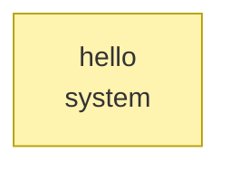
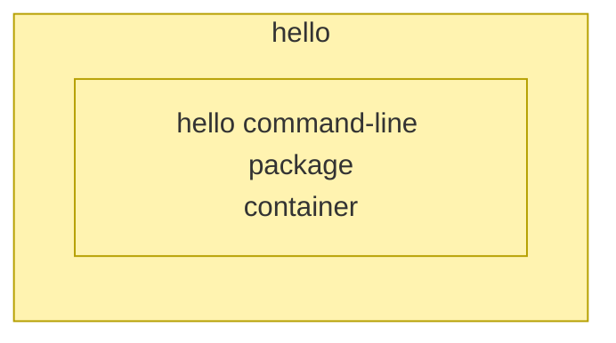
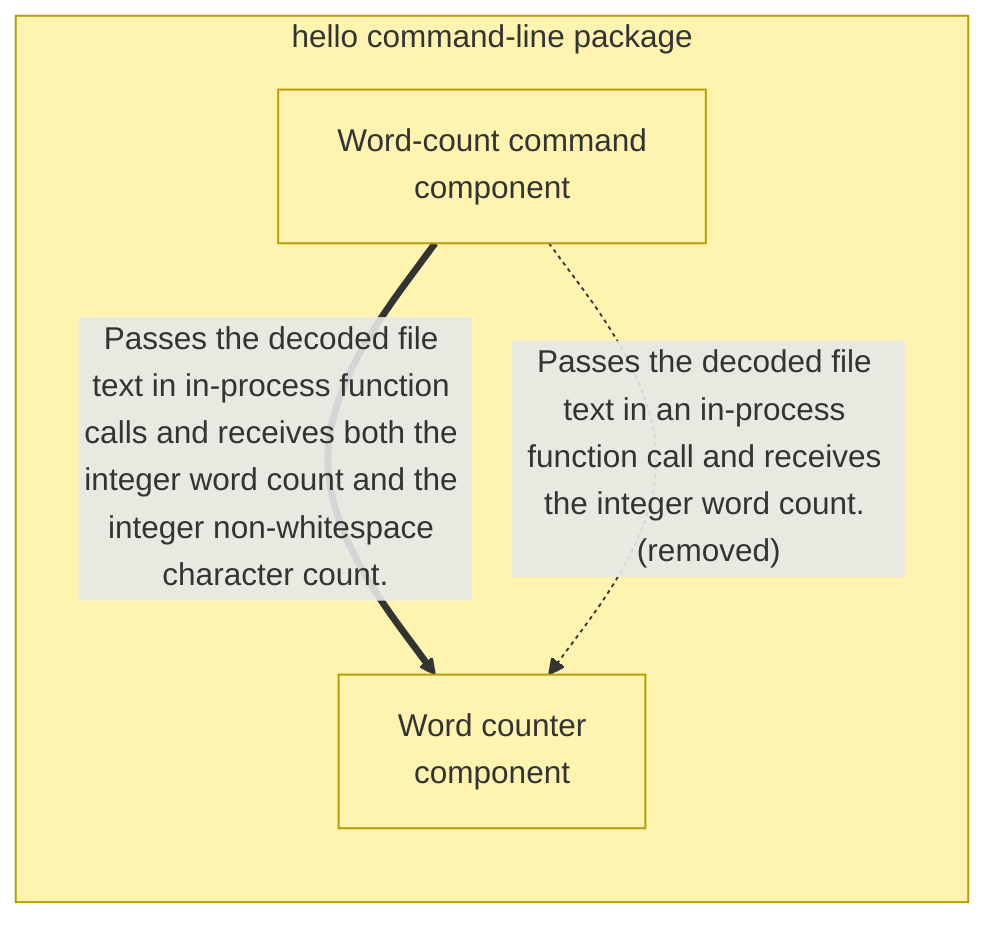

# Feature: Non-whitespace character count alongside word count

## Blueprint

### Context

Currently, the `wordcount` command reports only the whitespace-separated word count of a UTF-8 file. Users inspecting text files also need to know the volume of non-whitespace characters (excluding spaces, tabs, newlines, and other Unicode whitespace) without running a separate tool or passing extra flags.

This feature extends the pure `hello.counter` core with non-whitespace character counting and updates `wordcount`'s default stdout output to report both word count and non-whitespace character count together in a single invocation, while preserving the existing core/I/O boundary, single-file UTF-8 operating model, error-handling contract, and zero-runtime-dependency footprint.

### Feature Contract

- **C4 model elements involved:**
  - hello
  - hello-cli
  - word-count-command
  - word-counter
- **API Contracts:**
  - src/hello/counter.py: count_non_whitespace_chars(text: str) -> int returning the number of characters ch in text for which ch.isspace() is False (alongside existing count_words(text: str) -> int)
  - src/hello/cli.py: main(argv: list[str] | None = None) -> int (existing signature preserved)
  - wordcount PATH console script (pyproject.toml [project.scripts]): on a readable UTF-8 file, writes 'words: <word_count>\nnon-whitespace chars: <char_count>\n' to stdout and exits with status 0
- **Data Models:**
  - In-memory UTF-8 decoded str passed from hello.cli to hello.counter counting functions
  - Two non-negative int metrics (word count and non-whitespace character count) returned by hello.counter
- **Dependencies:**
  - Depends on:
    - Python standard library only (ADR-0001)
    - Existing SPEC-0001 word-count implementation in src/hello/counter.py and UTF-8 CLI shell in src/hello/cli.py
    - Quality Gate toolchain (ruff, mypy, pytest) declared in the dev dependency group (ADR-0003)
  - Needed by:
    - Local CLI users inspecting UTF-8 text files with wordcount
- **Constraints:**
  - No third-party runtime dependencies; [project].dependencies in pyproject.toml must remain empty (ADR-0001)
  - hello.counter must remain pure and perform no file, process, or console I/O (ADR-0002)
  - Single-file UTF-8 CLI scope only: no total character counts including whitespace, line counts, byte sizes, stdin streaming, multi-file arguments, or directory traversal
  - All four Quality Gate commands (uv run ruff format --check ., uv run ruff check ., uv run mypy --strict src tests, uv run pytest) must exit 0 (ADR-0003)
- **ADRs:**
  - ADR-0001
  - ADR-0002
  - ADR-0003
  - ADR-0004
  - ADR-0005
- **Critical components:** (none)

## Architecture changes

**Summary:** Expand the pure counting core and default CLI command output to compute and report non-whitespace character counts alongside word counts in a single invocation.

### Elements changed

| ID | Unit | Level | Parent | Owns | Does NOT own | Deployment | Tech Family |
|----|------|-------|--------|------|--------------|------------|-------------|
| hello | hello | system |  | Giving users local, dependency-free text utilities, reporting the word count and non-whitespace character count of one text file. | Total character counts including whitespace, line counts, byte sizes, batch or stdin processing, non-UTF-8 encodings, or distribution through a public package index. | Installed from the repository into a local Python environment on the user's machine. | Python (current stable release), standard library only |
| hello-cli | hello command-line package | container | hello | The installable src-layout hello package and its console command that takes one file path, prints that file's word count and non-whitespace character count by default, and exits with a status code. | Any network access, persistent state, configuration files, or third-party runtime dependencies. | Run as a local process on the user's machine after installing the package from the repository into the project environment. | Python standard library; console entry point declared in pyproject.toml; environment managed with the existing lockfile tooling |
| word-count-command | Word-count command | component | hello-cli | Parsing the single file-path argument, reading the file as UTF-8 text, passing the text to the counter, printing both the word count and non-whitespace character count by default, and turning a missing file, unreadable file or undecodable content into a one-line message on standard error with a non-zero exit status. | The definitions of what constitutes a word or a non-whitespace character, or counting logic of any kind. |  | Python standard library |
| word-counter | Word counter | component | hello-cli | The pure text-counting rules: counting words (runs of non-whitespace characters separated by whitespace) and counting non-whitespace characters (excluding whitespace) in a given text, returning integer counts. | File access, encoding, argument handling, output formatting or exit codes; it never touches the filesystem or the process. |  | Python standard library |

### Relations added

| From | To | Description |
|------|----|-------------|
| word-count-command | word-counter | Passes the decoded file text in in-process function calls and receives both the integer word count and the integer non-whitespace character count. |

### Relations removed

| From | To | Description |
|------|----|-------------|
| word-count-command | word-counter | Passes the decoded file text in an in-process function call and receives the integer word count. |

### Diagrams

#### Context



#### Container



#### Component: hello command-line package



## Contract

### Definition of Done

- [ ] `src/hello/counter.py` defines `count_non_whitespace_chars(text: str) -> int`, returning the count of characters `ch` where `ch.isspace()` is `False`.
- [ ] `wordcount PATH` on a readable UTF-8 file writes `words: <word_count>\nnon-whitespace chars: <char_count>\n` to stdout and exits 0.
- [ ] `README.md` documents the dual-count output format and non-whitespace character rule.
- [ ] Tests and all four Quality Gate commands (`ruff format --check .`, `ruff check .`, `mypy --strict src tests`, `pytest`) pass.

### Regression Guardrails

- `hello.counter.count_words(text: str) -> int` preserves its `SPEC-0001` behavior and stays pure (no I/O, ADR-0002).
- Existing `SPEC-0001` error handling (missing/unreadable/invalid-UTF-8 files, invalid args) and exit codes remain unchanged.
- `pyproject.toml` `[project].dependencies` remains empty (ADR-0001) and `src/hello/` package surface stays intact.

### Scenarios

```gherkin
Scenario: count_non_whitespace_chars counts non-whitespace characters
  Given  the string "Hello, world!\n"
  When  count_non_whitespace_chars is called with that string
  Then  it returns 12

Scenario: wordcount prints labeled word and non-whitespace character counts for a UTF-8 file
  Given  a readable UTF-8 file containing "Hello, world!\n"
  When  wordcount is invoked with that file path
  Then  stdout is "words: 2\nnon-whitespace chars: 12\n"
  And  stderr is empty
  And  the exit status is 0

Scenario: wordcount prints zero for both counts on an empty or whitespace-only file
  Given  a readable UTF-8 file containing only whitespace
  When  wordcount is invoked with that file path
  Then  stdout is "words: 0\nnon-whitespace chars: 0\n"
  And  stderr is empty
  And  the exit status is 0

Scenario: Guardrail: missing file preserves SPEC-0001 single-line error and exit status 1
  Given  a file path that does not exist
  When  wordcount is invoked with that missing path
  Then  stderr is "wordcount: error: file not found: PATH\n" without a traceback
  And  stdout is empty
  And  the exit status is 1
```

## Changelog

| Version | Date | Summary | Triggered by |
|---------|------|---------|--------------|

## Sign-Off

**Authored by:** openrouter:google/gemini-4-hydrogen  
**Reviewed by:** _(pending)_ — _(pending)_

**Ready for PBI_PLANNING:** [ ] Yes [ ] No
