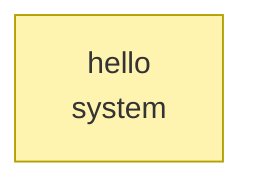
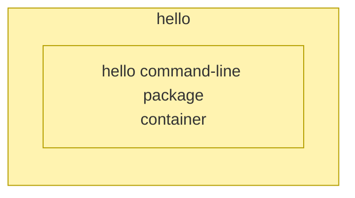
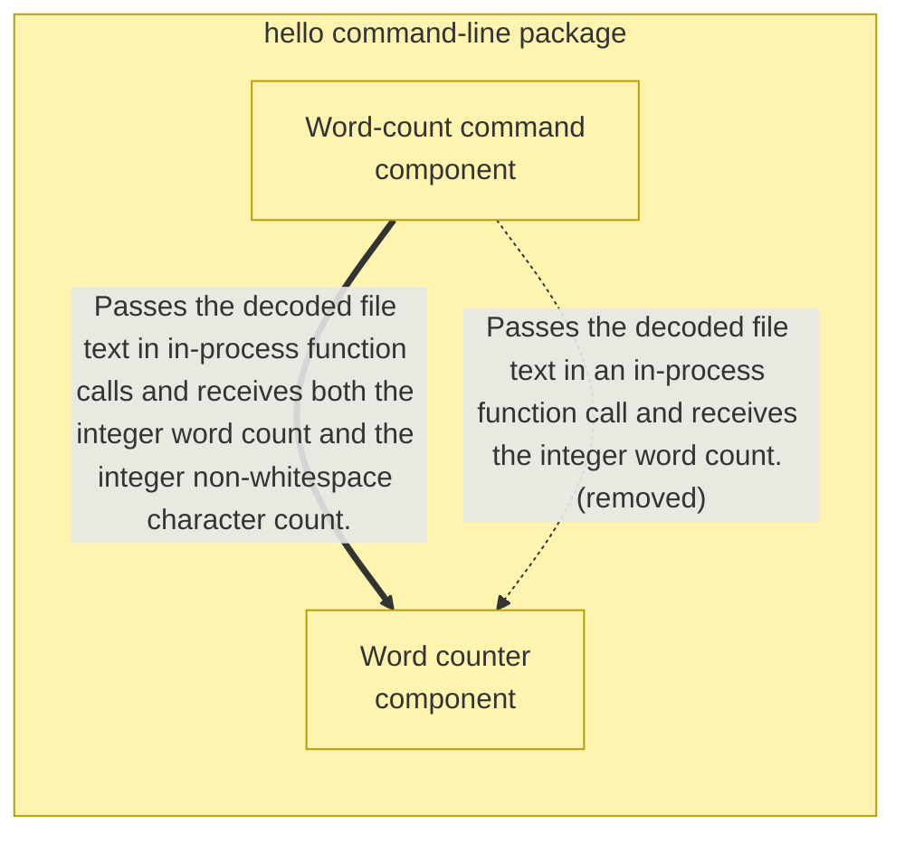

# Feature: Non-whitespace character count alongside word count

## Blueprint

### Context

Currently, the `wordcount` command reports only the whitespace-separated word count of a UTF-8 file. Users inspecting text files also need to know the volume of non-whitespace characters (excluding spaces, tabs, newlines, and other Unicode whitespace) without running a separate tool or passing extra flags.

This feature extends the pure `hello.counter` core with non-whitespace character counting and updates `wordcount`'s default stdout output to report both word count and non-whitespace character count together in a single invocation, while preserving the existing core/I/O boundary, single-file UTF-8 operating model, error-handling contract, and zero-runtime-dependency footprint.

### Feature Contract

- **C4 model elements involved:**
  - hello
  - hello-cli
  - word-count-command
  - word-counter
- **API Contracts:**
  - src/hello/counter.py: count_non_whitespace_chars(text: str) -> int returning the number of characters ch in text for which ch.isspace() is False (alongside existing count_words(text: str) -> int)
  - src/hello/cli.py: main(argv: list[str] | None = None) -> int (existing signature preserved)
  - wordcount PATH console script (pyproject.toml [project.scripts]): on a readable UTF-8 file, writes 'words: <word_count>\nnon-whitespace chars: <char_count>\n' to stdout and exits with status 0
- **Data Models:**
  - In-memory UTF-8 decoded str passed from hello.cli to hello.counter counting functions
  - Two non-negative int metrics (word count and non-whitespace character count) returned by hello.counter
- **Dependencies:**
  - Depends on:
    - Python standard library only (ADR-0001)
    - Existing SPEC-0001 word-count implementation in src/hello/counter.py and UTF-8 CLI shell in src/hello/cli.py
    - Quality Gate toolchain (ruff, mypy, pytest) declared in the dev dependency group (ADR-0003)
  - Needed by:
    - Local CLI users inspecting UTF-8 text files with wordcount
- **Constraints:**
  - No third-party runtime dependencies; [project].dependencies in pyproject.toml must remain empty (ADR-0001)
  - hello.counter must remain pure and perform no file, process, or console I/O (ADR-0002)
  - Single-file UTF-8 CLI scope only: no total character counts including whitespace, line counts, byte sizes, stdin streaming, multi-file arguments, or directory traversal
  - All four Quality Gate commands (uv run ruff format --check ., uv run ruff check ., uv run mypy --strict src tests, uv run pytest) must exit 0 (ADR-0003)
- **ADRs:**
  - ADR-0001
  - ADR-0002
  - ADR-0003
  - ADR-0004
  - ADR-0005
- **Critical components:** (none)

## Architecture changes

**Summary:** Expand the pure counting core and default CLI command output to compute and report non-whitespace character counts alongside word counts in a single invocation.

### Elements changed

| ID | Unit | Level | Parent | Owns | Does NOT own | Deployment | Tech Family |
|----|------|-------|--------|------|--------------|------------|-------------|
| hello | hello | system |  | Giving users local, dependency-free text utilities, reporting the word count and non-whitespace character count of one text file. | Total character counts including whitespace, line counts, byte sizes, batch or stdin processing, non-UTF-8 encodings, or distribution through a public package index. | Installed from the repository into a local Python environment on the user's machine. | Python (current stable release), standard library only |
| hello-cli | hello command-line package | container | hello | The installable src-layout hello package and its console command that takes one file path, prints that file's word count and non-whitespace character count by default, and exits with a status code. | Any network access, persistent state, configuration files, or third-party runtime dependencies. | Run as a local process on the user's machine after installing the package from the repository into the project environment. | Python standard library; console entry point declared in pyproject.toml; environment managed with the existing lockfile tooling |
| word-count-command | Word-count command | component | hello-cli | Parsing the single file-path argument, reading the file as UTF-8 text, passing the text to the counter, printing both the word count and non-whitespace character count by default, and turning a missing file, unreadable file or undecodable content into a one-line message on standard error with a non-zero exit status. | The definitions of what constitutes a word or a non-whitespace character, or counting logic of any kind. |  | Python standard library |
| word-counter | Word counter | component | hello-cli | The pure text-counting rules: counting words (runs of non-whitespace characters separated by whitespace) and counting non-whitespace characters (excluding whitespace) in a given text, returning integer counts. | File access, encoding, argument handling, output formatting or exit codes; it never touches the filesystem or the process. |  | Python standard library |

### Relations added

| From | To | Description |
|------|----|-------------|
| word-count-command | word-counter | Passes the decoded file text in in-process function calls and receives both the integer word count and the integer non-whitespace character count. |

### Relations removed

| From | To | Description |
|------|----|-------------|
| word-count-command | word-counter | Passes the decoded file text in an in-process function call and receives the integer word count. |

### Diagrams

#### Context



#### Container



#### Component: hello command-line package



## Contract

### Definition of Done

- [ ] src/hello/counter.py defines `count_non_whitespace_chars(text: str) -> int`, returning the number of characters `ch` in `text` for which `ch.isspace()` is False.
- [ ] count_non_whitespace_chars returns 0 for an empty string and for a string containing only ASCII or Unicode whitespace characters.
- [ ] count_non_whitespace_chars excludes spaces, tabs, and newlines while counting attached punctuation and non-ASCII UTF-8 characters: `"  alpha\t\tbeta\n\ngamma  "` returns 14, `"Hello, world!\n"` returns 12, and `"café naïve 日本"` returns 11.
- [ ] Running `wordcount PATH` on a readable UTF-8 file writes `words: <word_count>\nnon-whitespace chars: <char_count>\n` to stdout, writes nothing to stderr, and exits with status 0.
- [ ] Running `wordcount PATH` on an empty file or a whitespace-only file writes `words: 0\nnon-whitespace chars: 0\n` to stdout and exits with status 0.
- [ ] Running `wordcount PATH` on a readable UTF-8 file containing `"Hello, world!\n"` writes `words: 2\nnon-whitespace chars: 12\n` to stdout and exits with status 0.
- [ ] README.md documents the default dual-count output format (`words: <word_count>` and `non-whitespace chars: <char_count>`) and the non-whitespace character rule alongside the existing install, run, word rule, and error exit status documentation.
- [ ] Affected default-output tests (tests/test_cli.py, tests/test_console_script.py, tests/features/wordcount-prints-the-count-of-a-simple-file.feature, tests/step_defs/test_wordcount_prints_the_count_of_a_simple_file.py, and tests/test_readme.py) verify the dual-count output and README documentation, and all four Quality Gate commands exit 0.

### Regression Guardrails

- hello.counter.count_words(text: str) -> int preserves its exact SPEC-0001 behavior and signature for existing callers (len(text.split()), returning 0 for empty or whitespace-only strings and treating attached punctuation and non-ASCII characters as part of words).
- hello.counter keeps the ADR-0002 architecture boundary: it performs no file, process, or console I/O and imports no I/O or CLI modules.
- Error handling for missing files (`wordcount: error: file not found: PATH`, exit status 1), unreadable files (`wordcount: error: cannot read file: ...`, exit status 1), and invalid UTF-8 files (`wordcount: error: file is not valid UTF-8 text: PATH`, exit status 1) still writes exactly one line to stderr, nothing to stdout, and never emits a Python traceback.
- Invoking `wordcount` with zero arguments or more than one argument still prints argparse usage to stderr, writes nothing to stdout, and exits with status 2.
- pyproject.toml [project].dependencies remains empty, ruff/mypy/pytest remain only in the dev dependency group, and `uv lock --check` still exits 0.
- `import hello` still succeeds with all existing exports in src/hello/__init__.py intact, src/hello/py.typed remains present, and package code stays under src/hello/.

### Scenarios

```gherkin
Scenario: count_non_whitespace_chars counts non-whitespace characters excluding spaces, tabs, and newlines
  Given  the string "  alpha\t\tbeta\n\ngamma  " containing spaces, tabs, and newlines
  When  count_non_whitespace_chars is called with that string
  Then  it returns 14

Scenario: count_non_whitespace_chars returns zero for an empty string
  Given  an empty string ""
  When  count_non_whitespace_chars is called with that string
  Then  it returns 0

Scenario: count_non_whitespace_chars returns zero for a whitespace-only string
  Given  a string " \t\n\r\u00a0" containing only ASCII and Unicode whitespace
  When  count_non_whitespace_chars is called with that string
  Then  it returns 0

Scenario: count_non_whitespace_chars counts attached punctuation while excluding whitespace
  Given  the string "Hello, world!\n" containing attached punctuation and whitespace
  When  count_non_whitespace_chars is called with that string
  Then  it returns 12

Scenario: count_non_whitespace_chars counts non-ASCII UTF-8 characters while excluding spaces
  Given  the string "café naïve 日本" containing non-ASCII UTF-8 characters and spaces
  When  count_non_whitespace_chars is called with that string
  Then  it returns 11

Scenario: wordcount prints labeled word and non-whitespace character counts for a UTF-8 file
  Given  a readable UTF-8 file containing "Hello, world!\n"
  When  wordcount is invoked with that file path
  Then  stdout is "words: 2\nnon-whitespace chars: 12\n"
  And  stderr is empty
  And  the exit status is 0

Scenario: wordcount prints zero for both counts on an empty file
  Given  a readable empty UTF-8 file
  When  wordcount is invoked with that file path
  Then  stdout is "words: 0\nnon-whitespace chars: 0\n"
  And  stderr is empty
  And  the exit status is 0

Scenario: wordcount prints zero for both counts on a whitespace-only file
  Given  a readable UTF-8 file containing only "  \t\n  "
  When  wordcount is invoked with that file path
  Then  stdout is "words: 0\nnon-whitespace chars: 0\n"
  And  stderr is empty
  And  the exit status is 0

Scenario: wordcount prints accurate dual counts for a non-ASCII UTF-8 file
  Given  a readable UTF-8 file containing "café naïve 日本"
  When  wordcount is invoked with that file path
  Then  stdout is "words: 3\nnon-whitespace chars: 11\n"
  And  stderr is empty
  And  the exit status is 0

Scenario: Default dual-count output contract test passes
  Given  the default output contract test in tests/test_cli.py
  When  the test tests/test_cli.py::test_default_output_reports_words_and_non_whitespace_chars runs
  Then  it passes

Scenario: README documents the default dual-count output and non-whitespace character rule
  Given  the repository README.md file
  When  README.md is inspected for CLI output and counting rules
  Then  README.md documents the "words: <word_count>" and "non-whitespace chars: <char_count>" output format
  And  README.md documents that non-whitespace characters exclude spaces, tabs, newlines, and other whitespace
  And  README.md still documents the install step, run step, word rule, and error exit statuses

Scenario: All four Quality Gate commands pass after the change
  Given  all source, test, and documentation changes are present in the repository
  When  the four Quality Gate commands are executed
  Then  uv run ruff format --check . exits 0
  And  uv run ruff check . exits 0
  And  uv run mypy --strict src tests exits 0
  And  uv run pytest exits 0

Scenario: Guardrail: count_words preserves existing whitespace-separated word counting
  Given  the existing count_words function in src/hello/counter.py and the input "Hello, world! It's-fine."
  When  count_words is called with that input
  Then  it still returns 3, matching SPEC-0001 behavior

Scenario: Guardrail: hello.counter performs no file, process, or console I/O
  Given  the architecture layering test suite in tests/arch/test_layering.py
  When  pytest runs tests/arch/test_layering.py
  Then  the layering tests pass, confirming hello.counter remains pure and performs no I/O

Scenario: Guardrail: missing file preserves SPEC-0001 single-line error and exit status 1
  Given  a file path that does not exist
  When  wordcount is invoked with that missing path
  Then  stderr is "wordcount: error: file not found: PATH\n" without a traceback
  And  stdout is empty
  And  the exit status is 1

Scenario: Guardrail: invalid UTF-8 file preserves SPEC-0001 single-line error and exit status 1
  Given  a readable path to a file containing invalid UTF-8 bytes
  When  wordcount is invoked with that file path
  Then  stderr is "wordcount: error: file is not valid UTF-8 text: PATH\n" without a traceback
  And  stdout is empty
  And  the exit status is 1

Scenario: Guardrail: invalid argument count preserves argparse usage error and exit status 2
  Given  no file path argument supplied to wordcount
  When  wordcount is invoked with no arguments
  Then  stderr contains argparse usage text
  And  stdout is empty
  And  the exit status is 2

Scenario: Guardrail: runtime dependencies remain empty and lockfile stays consistent
  Given  the repository pyproject.toml and uv.lock files
  When  tests/arch/test_dependencies.py and uv lock --check are executed
  Then  tests/arch/test_dependencies.py passes confirming [project].dependencies is empty
  And  uv lock --check exits with status 0

Scenario: Guardrail: hello package import surface and py.typed marker remain intact
  Given  the hello package under src/hello/
  When  hello is imported and src/hello/py.typed is checked
  Then  import hello succeeds with all prior exports intact
  And  src/hello/py.typed is present
```

## Changelog

| Version | Date | Summary | Triggered by |
|---------|------|---------|--------------|

## Sign-Off

**Authored by:** openrouter:google/gemini-4-hydrogen  
**Reviewed by:** _(pending)_ — _(pending)_

**Ready for PBI_PLANNING:** [ ] Yes [ ] No
