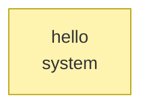
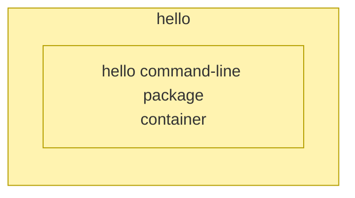
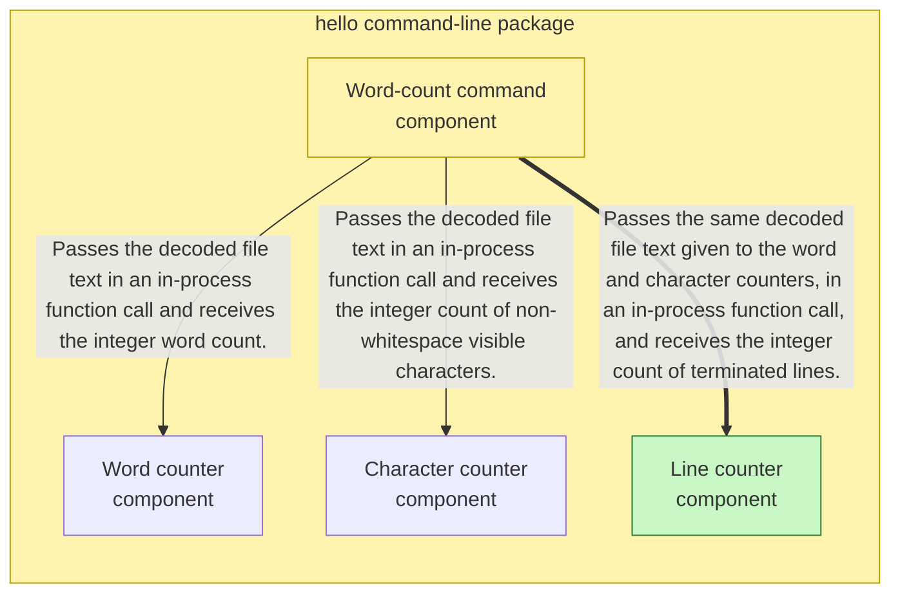

# Feature: Line count in word-count output

## Blueprint

### Context

Users who run `wordcount PATH` today get the word and visible-character counts of a file, but they must reach for a second tool to learn how many lines it has. DG-0003 and STRAT-0003 settle that every successful run always reports the line count on the same stdout line, as `words: <N> characters: <M> lines: <L>`, with no new flag and with every existing behaviour intact.

The line rule is deliberately broader than `wc -l`. A line is a segment ended by a terminator, and an unterminated final segment is not counted. At human review's request, the terminator set is enumerated explicitly rather than inherited silently from the interpreter: LF, CR, CRLF (counted once), VT, FF, FS, GS, RS, NEL, LS and PS. This is exactly the str.splitlines() boundary set, and a cross-check test exposes any drift. The rule lives in a new pure line counter beside the word and character counters. The command shell passes it the same text it already decodes once. Universal-newline translation (CRLF→LF, lone CR→LF), if the existing read applies it, preserves the number of terminators, so no change to decoding or error behaviour is needed.

### Feature Contract

- **C4 model elements involved:**
  - hello
  - hello-cli
  - word-count-command
  - line-counter
- **API Contracts:**
  - CLI: `wordcount PATH` (unchanged invocation). On success, prints exactly one stdout line `words: <N> characters: <M> lines: <L>\n` and exits 0. On error, the existing single stderr line is printed with exit 1, or argparse usage with exit 2, and nothing is printed on stdout.
  - hello.lines.count_lines(text: str) -> int — pure function that returns the number of line terminators in text, with CRLF counted once.
  - hello.lines.LINE_TERMINATORS: frozenset[str] — the ten terminator code points U+000A, U+000B, U+000C, U+000D, U+001C, U+001D, U+001E, U+0085, U+2028 and U+2029.
  - hello.cli.main(argv: list[str] | None = None) -> int — unchanged signature; now also calls hello.lines.count_lines on the same decoded text.
- **Data Models:**
  - Success output line: `words: <N> characters: <M> lines: <L>`, where N, M and L are non-negative decimal integers separated by single spaces.
  - LINE_TERMINATORS frozenset of ten single-code-point strings. The two-code-point CRLF pair is handled in count_lines as one terminator, not stored in the set.
- **Dependencies:**
  - Depends on:
    - Approved DG-0003 and STRAT-0003 (line rule, output format, invocation)
    - hello.counter.count_words (existing, SPEC-0001, ADR-0002)
    - hello.characters.count_characters (existing, SPEC-0002, ADR-0005)
    - hello.cli existing file read and UTF-8 decoding and error handling (SPEC-0001, ADR-0004), reused unchanged
    - Python standard library only (ADR-0001)
    - Quality Gate toolchain (ADR-0003)
    - ARCH-0001 v1.1 line-counter component and the word-count-command → line-counter communication, as proposed by the architectural elicitor
  - Needed by:
    - Future text statistics features (bytes, longest line), which would extend the same labeled success line (not planned)
- **Constraints:**
  - The line terminator set is exactly LF, CR, CRLF (one terminator), VT, FF, FS, GS, RS, NEL, LS and PS. No boundary that str.splitlines() recognises is excluded, and no other character is added.
  - An unterminated final segment is never counted as a line.
  - hello.lines performs no file, process or console I/O and imports only the standard library.
  - The file is read and decoded once, and the same str is passed to all three counters. No second read or decode path is added for lines.
  - No change to UTF-8 decoding, newline handling, error messages, exit statuses or argparse behaviour. If one appears necessary, the work stops and scope is revisited with the owner.
  - No new command-line flags; [project].dependencies stays empty.
  - All four Quality Gate commands pass before the change lands (ADR-0003).
- **ADRs:**
  - ADR-0001
  - ADR-0002
  - ADR-0003
  - ADR-0004
  - ADR-0005
  - ADR-0006
  - ADR-0007
  - ADR-0008
- **Critical components:** (none)

## Architecture changes

**Summary:** Add a pure line-counter component beside the word and character counters, and have the command append ` lines: <L>` to its single success line, so users get words, characters and lines from one invocation (SPEC-0003, from STRAT-0003).

### Elements added

| ID | Unit | Level | Parent | Owns | Does NOT own | Deployment | Tech Family |
|----|------|-------|--------|------|--------------|------------|-------------|
| line-counter | Line counter | component | hello-cli | The line rule. A line is a segment of text ended by a line terminator, and a final segment with no terminator is not counted. The terminator set is exactly the boundaries str.splitlines() recognises, listed explicitly so the rule does not depend on library behaviour: LF (U+000A), CR (U+000D), the CRLF pair (U+000D U+000A, counted as one terminator), VT (U+000B), FF (U+000C), FS (U+001C), GS (U+001D), RS (U+001E), NEL (U+0085), LS (U+2028) and PS (U+2029). It counts the terminated lines in a given text and returns the number. | The definition of a word or a visible character, file access, encoding or newline translation, argument handling, output formatting or exit codes. It never touches the filesystem or the process, and it does not follow the LF-only wc -l convention. |  | Python standard library |

### Elements changed

| ID | Unit | Level | Parent | Owns | Does NOT own | Deployment | Tech Family |
|----|------|-------|--------|------|--------------|------------|-------------|
| hello | hello | system |  | Giving users local, dependency-free text utilities. It currently reports the word count, the non-whitespace character count and the terminated-line count of one text file in a single invocation. | Other text statistics beyond word, character and line counts (such as bytes, longest line or per-line output), batch or stdin processing, non-UTF-8 encodings, or distribution through a public package index. | Installed from the repository into a local Python environment on the user's machine. | Python (current stable release), standard library only |
| hello-cli | hello command-line package | container | hello | The installable src-layout hello package and its console command. The command takes one file path, prints that file's word, character and line counts on one line, and exits with a status code. | Any network access, persistent state, configuration files, command-line flags beyond the single PATH argument, or third-party runtime dependencies. | Run as a local process on the user's machine after installing the package from the repository into the project environment. | Python standard library; console entry point declared in pyproject.toml; environment managed with the existing lockfile tooling |
| word-count-command | Word-count command | component | hello-cli | Parsing the single file-path argument and reading the file once as UTF-8 text. It passes that same decoded text to the word counter, the character counter and the line counter, and prints the three counts as one line in the form `words: <N> characters: <M> lines: <L>`. It turns a missing file, an unreadable file or undecodable content into a one-line message on standard error, with a non-zero exit status and no counts on standard output; these messages and statuses are unchanged. | The definition of what a word, a visible character or a line is, or counting logic of any kind. It does not decode the file a second time or along a separate path for line counting. |  | Python standard library |

### Relations added

| From | To | Description |
|------|----|-------------|
| word-count-command | line-counter | Passes the same decoded file text given to the word and character counters, in an in-process function call, and receives the integer count of terminated lines. |

### Diagrams

#### Context



#### Container



#### Component: hello command-line package



## Contract

### Definition of Done

- [ ] src/hello/lines.py defines a module-level constant LINE_TERMINATORS: frozenset[str] that contains exactly these 10 single code points and no others: LF U+000A, VT U+000B, FF U+000C, CR U+000D, FS U+001C, GS U+001D, RS U+001E, NEL U+0085, LS U+2028 and PS U+2029.
- [ ] src/hello/lines.py defines count_lines(text: str) -> int. It returns the number of line terminators in text. Each code point in LINE_TERMINATORS is one terminator, and a CR immediately followed by LF (the CRLF pair) counts as exactly one terminator.
- [ ] count_lines does not count an unterminated final segment: count_lines('a') returns 0 and count_lines('a\nb') returns 1.
- [ ] count_lines('') returns 0.
- [ ] count_lines returns 0 for blank-only text containing no terminator, such as '  \t '.
- [ ] count_lines('\n\n') returns 2.
- [ ] For each of the 11 terminators (LF, CR, CRLF, VT, FF, FS, GS, RS, NEL, LS, PS), count_lines('a' + terminator) returns 1.
- [ ] count_lines('a\r\n') returns 1, so CRLF is a single boundary.
- [ ] count_lines('\r\r\n') returns 2: a lone CR followed by a CRLF pair.
- [ ] count_lines('\n\r') returns 2: LF followed by CR is two boundaries, not a pair.
- [ ] For the mixed text 'a\nb\rc\r\nd\x0be\x0cf\x1cg\x1dh\x1ei\x85j\u2028k\u2029', count_lines returns 11.
- [ ] Non-boundary characters do not end a line. For each of TAB U+0009, SPACE U+0020, US U+001F, NBSP U+00A0, ZERO WIDTH SPACE U+200B and IDEOGRAPHIC SPACE U+3000, count_lines('a' + c + 'b') returns 0.
- [ ] A cross-check test scans every code point from U+0000 to U+10FFFF, excluding surrogates. It confirms that LINE_TERMINATORS equals exactly the set of code points c for which ('a' + c + 'b').splitlines() has length 2. This exposes any drift between the enumerated set and the interpreter.
- [ ] hello.lines performs no file, process or console I/O and imports only the standard library.
- [ ] Running `wordcount PATH` on a readable UTF-8 file prints exactly one line of the form `words: <N> characters: <M> lines: <L>` followed by a newline to stdout. It prints nothing to stderr and exits with status 0.
- [ ] For a file containing 'hello world\nbye\n', `wordcount PATH` prints `words: 3 characters: 13 lines: 2`.
- [ ] For a file containing 'a\nb', `wordcount PATH` prints `words: 2 characters: 2 lines: 1`.
- [ ] For a file containing 'café' with no terminator, `wordcount PATH` prints `words: 1 characters: 4 lines: 0`.
- [ ] For a file containing '\n\n', `wordcount PATH` prints `words: 0 characters: 0 lines: 2`.
- [ ] For an empty file, `wordcount PATH` prints `words: 0 characters: 0 lines: 0`.
- [ ] For a file whose bytes are b'a\r\n', `wordcount PATH` reports `lines: 1`.
- [ ] For a file whose bytes are b'a\rb\r', `wordcount PATH` reports `lines: 2`.
- [ ] For a file containing 'a\u2028b\u2029\x0c' encoded as UTF-8, `wordcount PATH` reports `lines: 3`.
- [ ] hello.cli.main reads and decodes the file once. It obtains <L> from hello.lines.count_lines on the same decoded text string it passes to hello.counter.count_words and hello.characters.count_characters.
- [ ] Existing tests that assert the two-field `words: <N> characters: <M>` success line are updated to assert the three-field line. The affected tests are in tests/test_cli.py and the wordcount-prints-the-count-of-a-simple-file feature and its step definitions.
- [ ] README.md documents the `words: <N> characters: <M> lines: <L>` output line and the line rule. The line rule section lists the explicit terminator set, states that CRLF counts once and that an unterminated final line is not counted, and gives at least the examples 'a\nb' → 1, '\n\n' → 2, 'a\r\n' → 1 and empty → 0.
- [ ] README.md states how the line rule differs from `wc -l` (which counts only LF) and states that the earlier two-field output no longer applies.
- [ ] All four Quality Gate commands exit 0 on the finished change.

### Regression Guardrails

- The `wordcount PATH` invocation is unchanged: one positional PATH argument and no new flags. The console script `wordcount = "hello.cli:main"` remains declared in pyproject.toml.
- The word count <N> follows the unchanged SPEC-0001 word rule: a file containing '  alpha\t\tbeta\n\ngamma  ' still reports 3 words.
- The character count <M> follows the unchanged SPEC-0002 visible-character rule. A file containing 'café' still reports 4 characters, and the decomposed 'e' followed by U+0301 still counts as 1.
- hello.counter.count_words and hello.characters.count_characters return the same values as before, and neither performs file, process or console I/O.
- UTF-8 decoding is unchanged: no new decoding path, encoding option or newline-translation setting is introduced for line counting.
- A path that does not exist still prints exactly one line `wordcount: error: file not found: PATH` to stderr, prints nothing to stdout (no counts and no `lines:` field), and exits with status 1.
- A path that exists but cannot be read (a directory, or a file without read permission) still prints exactly one line starting with `wordcount: error: cannot read file:` to stderr, prints nothing to stdout, and exits with status 1.
- A file whose bytes are not valid UTF-8 still prints exactly one line `wordcount: error: file is not valid UTF-8 text: PATH` to stderr, prints nothing to stdout, and exits with status 1.
- No error case writes a Python traceback to stderr.
- Invoking `wordcount` with no argument, or with more than one argument, still prints argparse usage to stderr and exits with status 2.
- `import hello` still succeeds with every name src/hello/__init__.py exported before. src/hello/py.typed remains present, and the src layout is unchanged.
- pyproject.toml [project].dependencies stays empty, and ruff, mypy and pytest stay declared only in the `dev` dependency group.
- `uv lock --check` still exits 0.
- The AGENTS.md Toolchain table keeps its four Quality Gate rows, and its Judgment Boundaries bullets stay word for word.

### Scenarios

```gherkin
Scenario: LINE_TERMINATORS enumerates exactly the ten terminator code points
  Given  the module hello.lines is importable
  When  LINE_TERMINATORS is read
  Then  it equals frozenset({'\n', '\x0b', '\x0c', '\r', '\x1c', '\x1d', '\x1e', '\x85', '\u2028', '\u2029'})
  And  its length is 10

Scenario: each terminator alone ends one line
  Given  the text 'a' followed by one terminator, for each of LF '\n', CR '\r', CRLF '\r\n', VT '\x0b', FF '\x0c', FS '\x1c', GS '\x1d', RS '\x1e', NEL '\x85', LS '\u2028' and PS '\u2029'
  When  count_lines is called on that text
  Then  it returns 1 for every one of the 11 cases

Scenario: unterminated final segment is not counted
  Given  the texts 'a' and 'a\nb'
  When  count_lines is called on each
  Then  count_lines('a') returns 0
  And  count_lines('a\nb') returns 1

Scenario: empty text has zero lines
  Given  the empty string ''
  When  count_lines is called on it
  Then  it returns 0

Scenario: blank text without terminators has zero lines
  Given  the text '  \t '
  When  count_lines is called on it
  Then  it returns 0

Scenario: blank-only terminated lines are counted
  Given  the text '\n\n'
  When  count_lines is called on it
  Then  it returns 2

Scenario: CRLF is a single boundary
  Given  the text 'a\r\n'
  When  count_lines is called on it
  Then  it returns 1

Scenario: lone CR followed by CRLF is two boundaries
  Given  the text '\r\r\n'
  When  count_lines is called on it
  Then  it returns 2

Scenario: LF followed by CR is two boundaries
  Given  the text '\n\r'
  When  count_lines is called on it
  Then  it returns 2

Scenario: mixed terminators are each counted once
  Given  the text 'a\nb\rc\r\nd\x0be\x0cf\x1cg\x1dh\x1ei\x85j\u2028k\u2029'
  When  count_lines is called on it
  Then  it returns 11

Scenario: non-boundary characters do not end a line
  Given  the text 'a' + c + 'b', for each c in TAB '\t', SPACE ' ', US '\x1f', NBSP '\xa0', ZERO WIDTH SPACE '\u200b' and IDEOGRAPHIC SPACE '\u3000'
  When  count_lines is called on that text
  Then  it returns 0 for every one of the six cases

Scenario: enumerated terminator set matches str.splitlines boundaries
  Given  every code point from U+0000 to U+10FFFF, excluding surrogates U+D800 to U+DFFF
  When  the test tests/test_lines.py::test_line_terminators_match_str_splitlines_boundaries runs
  Then  it passes
  And  the test asserts that LINE_TERMINATORS equals the set of code points c for which ('a' + c + 'b').splitlines() has length 2

Scenario: line counter performs no I/O
  Given  the source of src/hello/lines.py
  When  the test tests/arch/test_layering.py::test_line_counter_performs_no_io runs
  Then  it passes
  And  the test asserts that hello.lines imports only standard-library modules and references none of open, print, input, sys.stdin, sys.stdout, sys.stderr, os, pathlib or subprocess

Scenario: success output is one labeled three-field line
  Given  a readable UTF-8 file containing 'hello world\nbye\n'
  When  the test tests/test_cli.py::test_success_output_is_one_labeled_three_field_line runs
  Then  it passes
  And  the test asserts that main([PATH]) returns 0, stdout matches the regular expression '^words: \d+ characters: \d+ lines: \d+\n$', and stderr is empty

Scenario: ordinary multi-line file reports words, characters and lines
  Given  a file containing 'hello world\nbye\n'
  When  `wordcount PATH` is run
  Then  stdout is exactly 'words: 3 characters: 13 lines: 2\n'
  And  stderr is empty
  And  the exit status is 0

Scenario: unterminated final line reported by the command
  Given  a file containing 'a\nb'
  When  `wordcount PATH` is run
  Then  stdout is exactly 'words: 2 characters: 2 lines: 1\n'
  And  the exit status is 0

Scenario: file without terminator reports zero lines
  Given  a file containing 'café' with no trailing terminator
  When  `wordcount PATH` is run
  Then  stdout is exactly 'words: 1 characters: 4 lines: 0\n'
  And  the exit status is 0

Scenario: blank-only file reports lines with zero words and characters
  Given  a file containing '\n\n'
  When  `wordcount PATH` is run
  Then  stdout is exactly 'words: 0 characters: 0 lines: 2\n'
  And  the exit status is 0

Scenario: empty file reports all zero counts
  Given  an empty file
  When  `wordcount PATH` is run
  Then  stdout is exactly 'words: 0 characters: 0 lines: 0\n'
  And  the exit status is 0

Scenario: CRLF file bytes count as one line
  Given  a file whose raw bytes are b'a\r\n'
  When  `wordcount PATH` is run
  Then  stdout is exactly 'words: 1 characters: 1 lines: 1\n'
  And  the exit status is 0

Scenario: lone CR file bytes count as terminators
  Given  a file whose raw bytes are b'a\rb\r'
  When  `wordcount PATH` is run
  Then  stdout is exactly 'words: 2 characters: 2 lines: 2\n'
  And  the exit status is 0

Scenario: Unicode line and paragraph separators and form feed in a file
  Given  a file containing 'a\u2028b\u2029\x0c' encoded as UTF-8
  When  `wordcount PATH` is run
  Then  stdout ends with 'lines: 3\n'
  And  the exit status is 0

Scenario: all three counts come from the same decoded text
  Given  hello.counter.count_words, hello.characters.count_characters and hello.lines.count_lines are patched with recording wrappers
  And  a file containing 'x y\n'
  When  hello.cli.main([PATH]) is called
  Then  each wrapper was called exactly once
  And  all three wrappers received the identical str object 'x y\n'
  And  main returns 0

Scenario: README documents the three-field line and the explicit line rule
  Given  the repository README.md
  When  its text is read
  Then  it contains 'words: <N> characters: <M> lines: <L>'
  And  it names each of LF, CR, CRLF, VT, FF, FS, GS, RS, NEL, LS and PS as line terminators
  And  it states that CRLF counts as one terminator and that an unterminated final line is not counted
  And  it mentions 'wc -l' and that it counts only LF
  And  it states that the two-field `words: <N> characters: <M>` output no longer applies

Scenario: Quality Gate passes on the finished change
  Given  the finished change checked out in the project environment
  When  `uv run ruff format --check .`, `uv run ruff check .`, `uv run mypy --strict src tests` and `uv run pytest` are each run
  Then  each of the four commands exits 0

Scenario: guardrail: invocation and console script unchanged
  Given  pyproject.toml after this change
  When  [project.scripts] is read and `wordcount` is invoked with `--lines` as an extra argument after PATH
  Then  [project.scripts] still declares wordcount = "hello.cli:main"
  And  the invocation with two arguments prints argparse usage to stderr and exits with status 2

Scenario: guardrail: existing word rule still reports 3 words
  Given  a file containing '  alpha\t\tbeta\n\ngamma  '
  When  `wordcount PATH` is run
  Then  stdout starts with 'words: 3 '
  And  the exit status is 0

Scenario: guardrail: existing character rule unchanged
  Given  the pre-existing tests in tests/test_characters.py and tests/test_counter.py
  When  they are run unchanged with `uv run pytest tests/test_characters.py tests/test_counter.py`
  Then  they all pass
  And  count_characters('e\u0301') still returns 1 and count_characters('café') still returns 4

Scenario: guardrail: missing file error unchanged and prints no counts
  Given  a path that does not exist
  When  `wordcount PATH` is run
  Then  stderr is exactly one line 'wordcount: error: file not found: PATH'
  And  stdout is empty
  And  the exit status is 1

Scenario: guardrail: unreadable path error unchanged
  Given  a path that is a directory
  When  `wordcount PATH` is run
  Then  stderr is exactly one line starting with 'wordcount: error: cannot read file:'
  And  stdout is empty
  And  the exit status is 1

Scenario: guardrail: invalid UTF-8 error unchanged
  Given  a file whose bytes are b'\xff\xfe\n'
  When  `wordcount PATH` is run
  Then  stderr is exactly one line 'wordcount: error: file is not valid UTF-8 text: PATH'
  And  stdout is empty
  And  the exit status is 1
  And  stderr does not contain 'Traceback'

Scenario: guardrail: argparse usage on wrong argument count unchanged
  Given  no PATH argument
  When  `wordcount` is run with no arguments
  Then  stderr contains 'usage:'
  And  the exit status is 2

Scenario: guardrail: package surface and dependencies unchanged
  Given  the project after this change
  When  `import hello` is executed and pyproject.toml is read and `uv lock --check` is run
  Then  the import succeeds and exposes every name it exported before
  And  src/hello/py.typed exists
  And  [project].dependencies is empty and ruff, mypy and pytest appear only in the dev dependency group
  And  `uv lock --check` exits 0

Scenario: guardrail: AGENTS.md toolchain and judgment boundaries unchanged
  Given  AGENTS.md after this change
  When  its Toolchain table and Judgment Boundaries section are read
  Then  the Toolchain table has exactly the four rows format, lint, type-check and test with their existing commands
  And  the Judgment Boundaries bullets match the previous text word for word
```

## Changelog

| Version | Date | Summary | Triggered by |
|---------|------|---------|--------------|

## Sign-Off

**Authored by:** openrouter:anthropic/claude-opus-5.5  
**Reviewed by:** Marco — mcrasso@marsie.io

**Ready for PBI_PLANNING:** [x] Yes [ ] No
