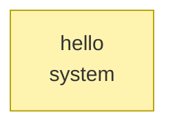
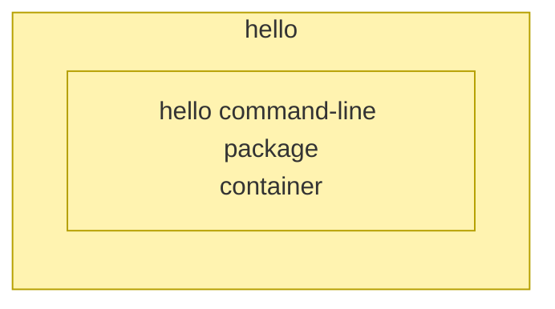
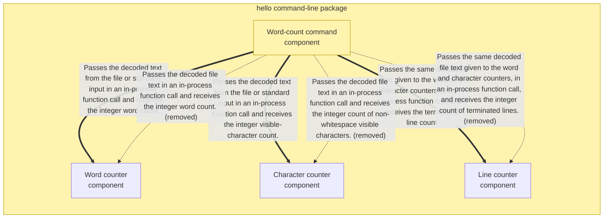

# Feature: Standard input through an explicit '-' argument

## Blueprint

### Context

Users want to count text piped into wordcount without writing a temporary file. Today `cat notes.txt | wordcount -` treats '-' as a path and fails with `file not found: -`. This gap was deferred across three strategies and DG-0004 names it as the core pipeline need.

STRAT-0004 commits to an explicit '-' argument whose text flows through the same single decode and counting path as a file. Counts, the output line and error contracts stay identical across sources. Only error messages name `<stdin>` instead of a path. No argument stays a usage error with exit status 2, and stdin is never read implicitly.

### Feature Contract

- **C4 model elements involved:**
  - hello
  - hello-cli
  - word-count-command
- **API Contracts:**
  - Console command `wordcount PATH | -`: exactly one positional argument, parsed by argparse in hello.cli.main(argv: list[str] | None = None) -> int.
  - `wordcount -` reads all bytes from sys.stdin.buffer until end of input.
  - `wordcount PATH` reads the file bytes as before.
  - Both sources pass their bytes to one shared UTF-8 decode step in src/hello/cli.py with no newline translation.
  - Success output for both sources: exactly one stdout line `words: <N> characters: <M> lines: <L>` (ADR-0008).
  - Invalid UTF-8 on stdin: one stderr line `wordcount: error: file is not valid UTF-8 text: <stdin>`, empty stdout, exit status 1 (ADR-0004).
  - Zero arguments, or more than one argument including `-` plus another: argparse usage on stderr, exit status 2.
- **Data Models:**
  - No new data model. The decoded text is a plain str passed unchanged to count_words, count_characters and count_lines.
  - The source name used in error messages is the PATH string for files and the literal `<stdin>` for '-'.
- **Dependencies:**
  - Depends on:
    - Architecture ARCH-0001 v1.2 update that moves stdin processing and the '-' argument out of the hello and hello-cli 'Does NOT own' lists.
    - hello.counter.count_words (existing, unchanged)
    - hello.characters.count_characters (existing, unchanged)
    - hello.lines.count_lines (existing, unchanged)
    - The four AGENTS.md Quality Gate commands (ADR-0003)
  - Needed by:
    - (none planned)
- **Constraints:**
  - Standard library only; [project].dependencies stays empty (ADR-0001).
  - Counting logic stays in the pure counters; stdin handling lives only in hello.cli (ADR-0002).
  - Stdin is decoded once, through the same decode step as files, never through sys.stdin's text layer.
  - Stdin is read only when the argument is exactly '-'.
  - File-path error messages and exit statuses are unchanged.
  - No new flags or arguments.
- **ADRs:**
  - ADR-0001
  - ADR-0002
  - ADR-0003
  - ADR-0004
  - ADR-0008
  - ADR-0009
- **Critical components:** (none)

## Architecture changes

**Summary:** Let wordcount read standard input through an explicit '-' argument, sharing the single decode and counting path with files (STRAT-0004).

### Elements changed

| ID | Unit | Level | Parent | Owns | Does NOT own | Deployment | Tech Family |
|----|------|-------|--------|------|--------------|------------|-------------|
| hello | hello | system |  | Giving users local, dependency-free text utilities. It currently reports the word count, the non-whitespace character count and the terminated-line count of one input in a single invocation. The input is one text file or standard input. | Other text statistics beyond word, character and line counts, such as bytes, longest line or per-line output. Several inputs in one invocation, totals, implicit or auto-detected stdin, non-UTF-8 encodings, or distribution through a public package index. | Installed from the repository into a local Python environment on the user's machine. | Python (current stable release), standard library only |
| hello-cli | hello command-line package | container | hello | The installable src-layout hello package and its console command. The command takes one file path, or the '-' argument for standard input. It prints that input's word, character and line counts on one line and exits with a status code. | Any network access, persistent state, configuration files, or third-party runtime dependencies. Command-line flags or arguments beyond the single PATH or '-' argument. Reading standard input when no argument is given. | Run as a local process on the user's machine after installing the package from the repository into the project environment. | Python standard library; console entry point declared in pyproject.toml; environment managed with the existing lockfile tooling |
| word-count-command | Word-count command | component | hello-cli | Parsing the single argument: a file path, or '-' for standard input. It reads the chosen source once and decodes it as UTF-8 along one shared path. It passes that same decoded text to the word, character and line counters. It prints the three counts as one line in the form `words: <N> characters: <M> lines: <L>`. It turns a missing file, an unreadable file or undecodable content into a one-line stderr message, a non-zero exit status and empty stdout. Messages for standard input name `<stdin>`, and file-path messages and statuses are unchanged. | The definition of what a word, a visible character or a line is, or counting logic of any kind. It does not decode text a second time, along a separate path per source, or with newline translation. It does not read standard input when no argument is given. A file literally named '-' is reached only through './-'. |  | Python standard library |

### Relations added

| From | To | Description |
|------|----|-------------|
| word-count-command | word-counter | Passes the decoded text from the file or standard input in an in-process function call and receives the integer word count. |
| word-count-command | character-counter | Passes the decoded text from the file or standard input in an in-process function call and receives the integer visible-character count. |
| word-count-command | line-counter | Passes the same decoded text given to the word and character counters, in an in-process function call, and receives the terminated-line count. |

### Relations removed

| From | To | Description |
|------|----|-------------|
| word-count-command | word-counter | Passes the decoded file text in an in-process function call and receives the integer word count. |
| word-count-command | character-counter | Passes the decoded file text in an in-process function call and receives the integer count of non-whitespace visible characters. |
| word-count-command | line-counter | Passes the same decoded file text given to the word and character counters, in an in-process function call, and receives the integer count of terminated lines. |

### Diagrams

#### Context



#### Container



#### Component: hello command-line package



## Contract

### Definition of Done

- [ ] Running `printf 'a b\n' | wordcount -` prints exactly `words: 2 characters: 2 lines: 1` followed by a newline to stdout, prints nothing to stderr, and exits with status 0.
- [ ] Running `wordcount -` with empty standard input prints exactly `words: 0 characters: 0 lines: 0` followed by a newline to stdout and exits with status 0.
- [ ] Running `wordcount -` with the bytes b'\xff\xfe' on standard input prints exactly one stderr line `wordcount: error: file is not valid UTF-8 text: <stdin>`, prints nothing to stdout, writes no traceback, and exits with status 1.
- [ ] For each byte sample b'a b\n', b'a\r\nb\r\n', b'a\rb\r' and 'café naïve 日本\n' encoded as UTF-8, `wordcount PATH` on a file holding the sample and `wordcount -` fed the sample on stdin print identical stdout lines.
- [ ] Running `wordcount - extra` prints argparse usage to stderr, prints nothing to stdout, and exits with status 2.
- [ ] README.md documents the `wordcount -` invocation, states that `-` reads standard input until end of input, and documents `wordcount ./-` for a file literally named `-`.

### Regression Guardrails

- Invoking `wordcount` with no argument still prints argparse usage to stderr and exits with status 2, and it does not read standard input.
- A file literally named `-` is still counted through `wordcount ./-` with the unchanged three-field output line.
- The existing SPEC-0001 to SPEC-0003 tests pass unchanged: no existing test function in tests/ is modified or removed, and `uv run pytest` exits 0.

### Scenarios

```gherkin
Scenario: piped text is counted through the dash argument
  Given  standard input holds the bytes b'a b\n'
  When  `wordcount -` runs
  Then  stdout is exactly `words: 2 characters: 2 lines: 1\n`
  And  stderr is empty
  And  the exit status is 0

Scenario: empty standard input reports all zeros
  Given  standard input holds zero bytes and is closed
  When  `wordcount -` runs
  Then  stdout is exactly `words: 0 characters: 0 lines: 0\n`
  And  the exit status is 0

Scenario: invalid UTF-8 on standard input fails with one line naming <stdin>
  Given  standard input holds the bytes b'\xff\xfe' and is closed
  When  `wordcount -` runs
  Then  stderr is exactly one line `wordcount: error: file is not valid UTF-8 text: <stdin>`
  And  stderr does not contain `Traceback`
  And  stdout is empty
  And  the exit status is 1

Scenario: file and standard input give identical output for the same bytes
  Given  the byte samples b'a b\n', b'a\r\nb\r\n', b'a\rb\r' and 'café naïve 日本\n' encoded as UTF-8
  And  each sample is written unchanged to its own temporary file
  When  for each sample, `wordcount PATH` runs on its file and `wordcount -` runs with the sample on standard input
  Then  for every sample, the two stdout lines are byte-for-byte identical
  And  for every sample, both runs exit with status 0
  And  the sample b'a\rb\r' reports `lines: 2` from both sources

Scenario: dash with a second argument is a usage error
  Given  standard input holds the bytes b'a b\n'
  When  `wordcount - extra` runs
  Then  stderr contains argparse usage text starting with `usage:`
  And  stdout is empty
  And  the exit status is 2

Scenario: README documents the dash argument and its workaround
  Given  the README.md file at the repository root
  When  the README text is read
  Then  it contains `wordcount -`
  And  it contains the phrase `end of input`
  And  it contains `./-`

Scenario: guardrail: no argument is still a usage error and does not read stdin
  Given  standard input is an open pipe holding the bytes b'a b\n' that is never closed
  When  `wordcount` runs with no argument and a 10 second timeout
  Then  the process finishes before the timeout
  And  stderr contains argparse usage text starting with `usage:`
  And  stdout is empty
  And  the exit status is 2

Scenario: guardrail: a file literally named dash is still counted through ./-
  Given  the working directory holds a file named `-` containing 'x y\n'
  And  standard input holds zero bytes and is closed
  When  `wordcount ./-` runs in that directory
  Then  stdout is exactly `words: 2 characters: 2 lines: 1\n`
  And  the exit status is 0

Scenario: guardrail: the existing SPEC-0001 to SPEC-0003 test suite passes unchanged
  Given  the test files tracked in tests/ before this change
  When  `uv run pytest` runs on the finished change
  Then  the exit status is 0
  And  `git diff` against the pre-change commit shows no modified or removed test function in those files
```

## Changelog

| Version | Date | Summary | Triggered by |
|---------|------|---------|--------------|

## Sign-Off

**Authored by:** openrouter:anthropic/claude-opus-5.5  
**Reviewed by:** _(pending)_ — _(pending)_

**Ready for PBI_PLANNING:** [ ] Yes [ ] No
