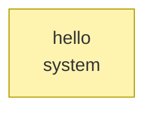
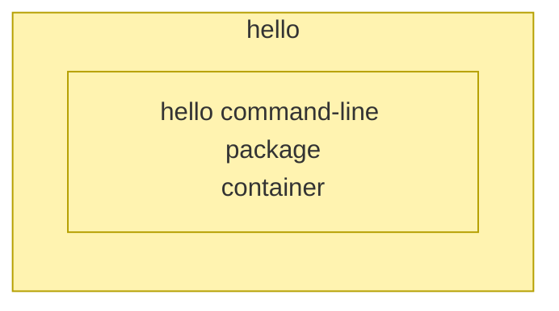
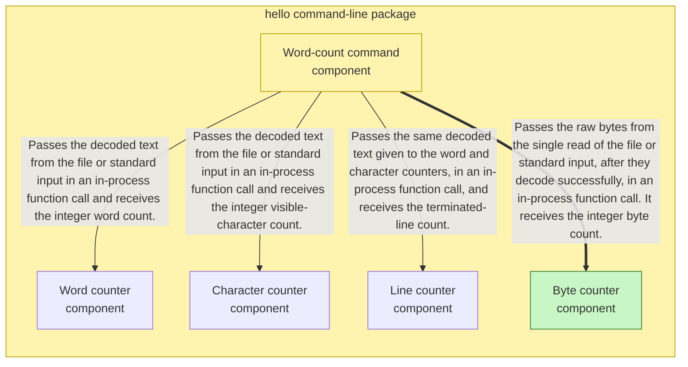

# Feature: Byte count in word-count output

## Blueprint

### Context

Users who size buffers, uploads or storage currently run a second tool to learn the input's byte size. wordcount already reads each input once as raw bytes, along one path shared by files and standard input (SPEC-0004).

This change adds a byte field to the success line, right after characters. The count comes from the raw bytes of that single read, so a file and '-' always agree. Invalid UTF-8 input keeps the existing error, with no byte count.

### Feature Contract

- **C4 model elements involved:**
  - hello
  - hello-cli
  - word-count-command
  - byte-counter
- **API Contracts:**
  - `wordcount PATH` and `wordcount -` print `words: <N> characters: <M> bytes: <B> lines: <L>` on success, exit 0
  - hello.byte_counter.count_bytes(data: bytes) -> int, returns len(data)
  - Error output and exit statuses unchanged (ADR-0004)
- **Data Models:**
  - The raw bytes of the single read, passed unchanged to count_bytes
  - The decoded text, passed to count_words, count_characters and count_lines
- **Dependencies:**
  - Depends on:
    - Shared single read and decode path for file and stdin (SPEC-0004, ADR-0009)
    - Word, character and line counters (existing)
    - Quality Gate toolchain (ADR-0003)
  - Needed by:
    - (none planned)
- **Constraints:**
  - Standard library only, no runtime dependencies
  - The input is read once, and the byte count uses those raw bytes
  - No new command-line flags or arguments
  - No byte count is printed on any error
  - Comprehension quizzes are not used for this feature
- **ADRs:**
  - ADR-0001
  - ADR-0002
  - ADR-0003
  - ADR-0004
  - ADR-0008
  - ADR-0009
  - ADR-0010
  - ADR-0011
- **Critical components:** (none)

## Architecture changes

**Summary:** Add a pure byte-counter fed the raw input bytes from the single read, and print a four-field success line, so users get byte size beside characters (STRAT-0005).

### Elements added

| ID | Unit | Level | Parent | Owns | Does NOT own | Deployment | Tech Family |
|----|------|-------|--------|------|--------------|------------|-------------|
| byte-counter | Byte counter | component | hello-cli | The byte rule: the byte count is the number of raw bytes in the input as read, before any decoding. It counts the bytes it is given and returns the number. | Reading the input, decoding, or deriving bytes from decoded text. It does not own the word, character or line rules, argument handling, output formatting or exit codes. It never touches the filesystem or the process. |  | Python standard library |

### Elements changed

| ID | Unit | Level | Parent | Owns | Does NOT own | Deployment | Tech Family |
|----|------|-------|--------|------|--------------|------------|-------------|
| hello | hello | system |  | Giving users local, dependency-free text utilities. It currently reports the word count, the non-whitespace character count, the raw byte count and the terminated-line count of one input in a single invocation. The input is one text file or standard input. | Other text statistics beyond word, character, byte and line counts, such as longest line or per-line output. Byte counts for input that is not valid UTF-8. Several inputs in one invocation, totals, implicit or auto-detected stdin, non-UTF-8 encodings, or distribution through a public package index. | Installed from the repository into a local Python environment on the user's machine. | Python (current stable release), standard library only |
| hello-cli | hello command-line package | container | hello | The installable src-layout hello package and its console command. The command takes one file path, or the '-' argument for standard input. It prints that input's word, character, byte and line counts on one line and exits with a status code. | Any network access, persistent state, configuration files, or third-party runtime dependencies. Command-line flags or arguments beyond the single PATH or '-' argument. Reading standard input when no argument is given. | Run as a local process on the user's machine after installing the package from the repository into the project environment. | Python standard library; console entry point declared in pyproject.toml; environment managed with the existing lockfile tooling |
| word-count-command | Word-count command | component | hello-cli | Parsing the single argument: a file path, or '-' for standard input. It reads the chosen source once as raw bytes and decodes them as UTF-8 along one shared path. It passes those same raw bytes to the byte counter. It passes the decoded text to the word, character and line counters. It prints the four counts as one line in the form `words: <N> characters: <M> bytes: <B> lines: <L>`. It turns a missing file, an unreadable file or undecodable content into a one-line stderr message, a non-zero exit status and empty stdout, with no byte count. Messages for standard input name `<stdin>`, and file-path messages and statuses are unchanged. | The definition of what a word, a visible character, a byte count or a line is, or counting logic of any kind. It does not read the input a second time, take the size from the file system, or re-encode decoded text. It does not decode text a second time, along a separate path per source, or with newline translation. It does not read standard input when no argument is given. A file literally named '-' is reached only through './-'. |  | Python standard library |

### Relations added

| From | To | Description |
|------|----|-------------|
| word-count-command | byte-counter | Passes the raw bytes from the single read of the file or standard input, after they decode successfully, in an in-process function call. It receives the integer byte count. |

### Diagrams

#### Context



#### Container



#### Component: hello command-line package



## Contract

### Definition of Done

- [ ] src/hello/byte_counter.py defines count_bytes(data: bytes) -> int, which returns len(data).
- [ ] count_bytes(b'') returns 0 and count_bytes(b'caf\xc3\xa9') returns 5.
- [ ] hello.byte_counter performs no file, process or console I/O and imports only the standard library.
- [ ] Running `wordcount PATH` on a readable UTF-8 file prints exactly one line `words: <N> characters: <M> bytes: <B> lines: <L>` and a newline to stdout. It prints nothing to stderr and exits with status 0.
- [ ] For a file containing 'café' encoded as UTF-8, `wordcount PATH` prints `words: 1 characters: 4 bytes: 5 lines: 0`.
- [ ] For an empty file, `wordcount PATH` prints `words: 0 characters: 0 bytes: 0 lines: 0`.
- [ ] For each SPEC-0004 byte sample, `wordcount PATH` and `wordcount -` print identical four-field lines. The expected lines are: b'a b\n' gives `words: 2 characters: 2 bytes: 4 lines: 1`. b'a\r\nb\r\n' gives `words: 2 characters: 2 bytes: 6 lines: 2`. b'a\rb\r' gives `words: 2 characters: 2 bytes: 4 lines: 2`. 'café naïve 日本\n' gives `words: 3 characters: 11 bytes: 20 lines: 1`.
- [ ] hello.cli.main reads the input once as raw bytes. It passes those same bytes to hello.byte_counter.count_bytes after they decode successfully. It never re-encodes decoded text or calls os.stat, os.path.getsize or Path.stat for the count.
- [ ] Existing tests that assert the three-field success line are updated to the four-field line, and no other assertion in them changes.
- [ ] README.md documents the `words: <N> characters: <M> bytes: <B> lines: <L>` line and the byte rule (raw input bytes before decoding). It states that the three-field form no longer applies.
- [ ] tests/arch/test_output_contract.py::test_success_line_is_four_labeled_fields exists and passes.
- [ ] tests/arch/test_layering.py::test_byte_counter_performs_no_io exists and passes.
- [ ] All four Quality Gate commands exit 0 on the finished change.

### Regression Guardrails

- The word count <N>, character count <M> and line count <L> keep the unchanged SPEC-0001, SPEC-0002 and SPEC-0003 rules.
- A file whose bytes are not valid UTF-8 still prints exactly one line `wordcount: error: file is not valid UTF-8 text: PATH` to stderr. It prints nothing to stdout, so no byte count appears, and exits with status 1.
- `wordcount -` with invalid UTF-8 on stdin still prints `wordcount: error: file is not valid UTF-8 text: <stdin>`, nothing to stdout, and exits 1.
- A missing path and an unreadable path keep their existing one-line stderr messages, empty stdout and exit status 1.
- No error case writes a Python traceback to stderr.
- The invocation is unchanged: one PATH or '-' argument, no new flags. No argument or extra arguments still give argparse usage and exit status 2, and no argument does not read stdin.
- A file literally named '-' is still counted through `wordcount ./-`.
- hello.counter.count_words, hello.characters.count_characters and hello.lines.count_lines return the same values as before.
- The input is still decoded once along the shared file and stdin path, with no newline translation.
- pyproject.toml [project].dependencies stays empty, `uv lock --check` exits 0, and the AGENTS.md Toolchain table and Judgment Boundaries stay word for word.
- `import hello` still succeeds with every name it exported before, src/hello/py.typed remains, and the src layout is unchanged.

### Scenarios

```gherkin
Scenario: byte counter counts raw bytes
  Given  the function hello.byte_counter.count_bytes
  When  it is called with b'caf\xc3\xa9' and with b''
  Then  it returns 5 for b'caf\xc3\xa9'
  And  it returns 0 for b''

Scenario: non-ASCII file reports its raw byte size beside characters
  Given  a file holding 'café' encoded as UTF-8 (5 bytes)
  When  the user runs `wordcount PATH` on that file
  Then  stdout is exactly `words: 1 characters: 4 bytes: 5 lines: 0` followed by a newline
  And  stderr is empty
  And  the exit status is 0

Scenario: empty file reports zero bytes
  Given  an empty file
  When  the user runs `wordcount PATH` on that file
  Then  stdout is exactly `words: 0 characters: 0 bytes: 0 lines: 0` followed by a newline
  And  the exit status is 0

Scenario: file and standard input report identical byte counts
  Given  a file holding the bytes b'a\r\nb\r\n'
  When  the user runs `wordcount PATH` on the file and `wordcount -` with the same bytes on stdin
  Then  both stdout lines are exactly `words: 2 characters: 2 bytes: 6 lines: 2` followed by a newline
  And  both exit statuses are 0

Scenario: guardrail: invalid UTF-8 still fails with no byte count
  Given  a file whose bytes are b'\xff\xfe'
  When  the user runs `wordcount PATH` on that file
  Then  stderr is exactly one line `wordcount: error: file is not valid UTF-8 text: PATH`
  And  stdout is empty, so no `bytes:` field is printed
  And  stderr contains no traceback
  And  the exit status is 1

Scenario: README documents the four-field line and byte rule
  Given  the finished README.md
  When  its text is read
  Then  it contains `words: <N> characters: <M> bytes: <B> lines: <L>`
  And  it states that bytes are counted from the raw input before decoding
  And  it states that the three-field output no longer applies

Scenario: four-field output contract test passes
  Given  the four-field success line decision
  When  the test tests/arch/test_output_contract.py::test_success_line_is_four_labeled_fields runs
  Then  it passes

Scenario: byte counter purity test passes
  Given  the pure byte counter decision
  When  the test tests/arch/test_layering.py::test_byte_counter_performs_no_io runs
  Then  it passes

Scenario: guardrail: Quality Gate passes with only success lines updated
  Given  the finished change, with existing tests edited only where they assert the success line
  When  the four Quality Gate commands run
  Then  each command exits 0
```

## Changelog

| Version | Date | Summary | Triggered by |
|---------|------|---------|--------------|

## Sign-Off

**Authored by:** openrouter:anthropic/claude-opus-5.5  
**Reviewed by:** Marco — mcrasso@marsie.io

**Ready for PBI_PLANNING:** [x] Yes [ ] No
