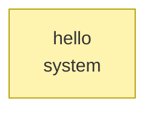
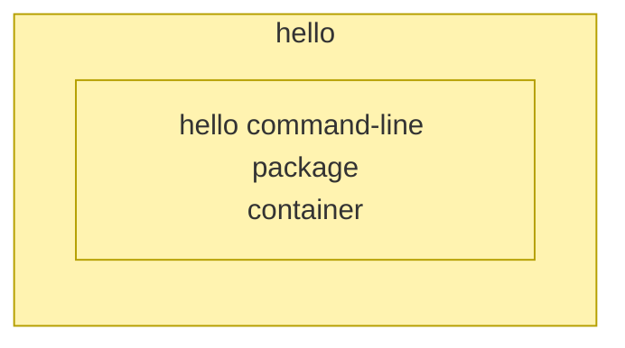
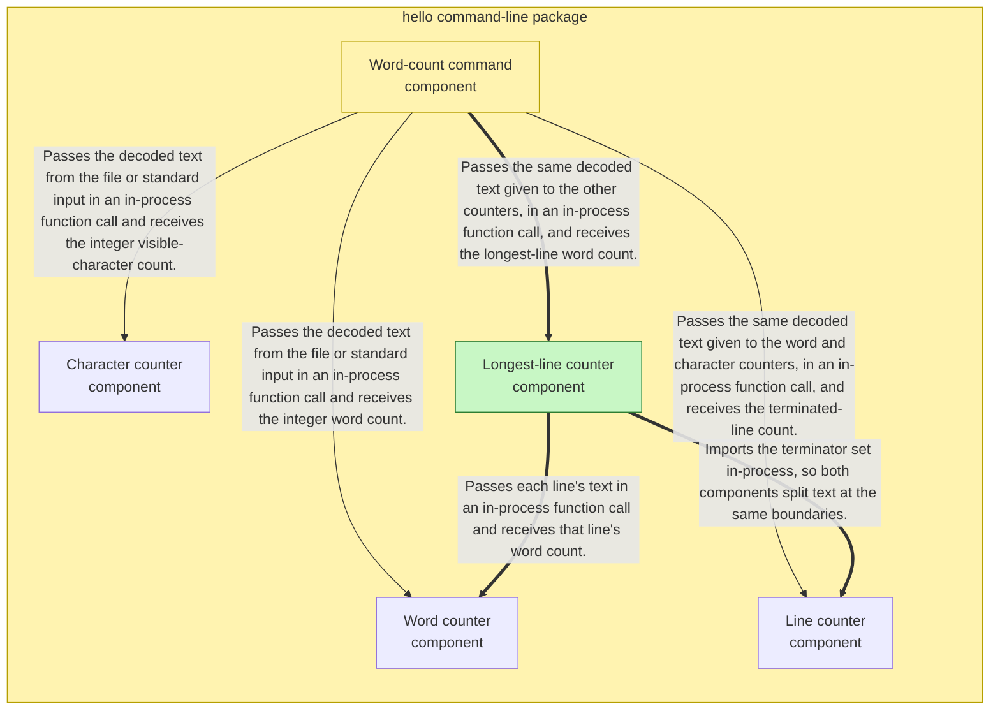

# Feature: Longest-line word count in word-count output

## Blueprint

### Context

The wordcount output line reports words, characters and terminated lines, but gives no figure for how long the longest line is. Users need other tools to find it. This feature appends one figure, the word count of the longest line, as the last field of the existing line.

The figure derives only from the word rule of SPEC-0001 and the terminator set of SPEC-0003, so no field can disagree with another. An unterminated final segment counts as a line for this figure only, while `lines` keeps excluding it. The README documents the difference with an example.

### Feature Contract

- **C4 model elements involved:**
  - hello
  - hello-cli
  - word-count-command
  - word-counter
  - line-counter
  - longest-line-counter
- **API Contracts:**
  - wordcount PATH and wordcount - print exactly one stdout line: `words: <N> characters: <M> lines: <L> longest_line_words: <K>`.
  - hello.longest_line.longest_line_words(text: str) -> int, pure and with no I/O, in src/hello/longest_line.py.
  - The invocation, error messages and exit statuses (0, 1, 2) are unchanged.
- **Data Models:**
  - longest_line_words result: a non-negative int, 0 when no line has a word.
  - Terminator set: hello.lines.LINE_TERMINATORS (frozenset[str] of 10 code points), reused unchanged, with CRLF as one terminator.
- **Dependencies:**
  - Depends on:
    - hello.counter.count_words (SPEC-0001, existing)
    - hello.lines.LINE_TERMINATORS (SPEC-0003, existing)
    - Shared stdin and file decode path in hello.cli (SPEC-0004, existing)
    - Python standard library only, with no new runtime dependency (ADR-0001)
    - Quality Gate commands from the AGENTS.md Toolchain table (ADR-0003)
  - Needed by:
    - README.md output and line-rule documentation
    - Repository tests and features that assert the output line
    - Users or scripts parsing the output line (none known beyond the README and repository tests)
- **Constraints:**
  - Existing fields keep their labels, order and meaning, and the new field is appended last.
  - The unterminated final segment counts for longest_line_words only, and the lines field stays unchanged.
  - No second definition of a word or a terminator is introduced.
  - No new flags or arguments, and no new third-party runtime dependency.
  - This spec supersedes the three-field success-line assertions of SPEC-0003 and SPEC-0004. Test edits are limited to those assertions, which is the allowed exception to the SPEC-0004 rule on editing existing tests.
  - The update of spec text under docs/specs/ has no behavioral test and is checked at review.
  - An input with no words on any line reports longest_line_words 0, as the strategy assumes. The owner confirms this at spec review.
- **ADRs:**
  - ADR-0001
  - ADR-0002
  - ADR-0003
  - ADR-0004
  - ADR-0007
  - ADR-0009
  - ADR-0012
  - ADR-0013
- **Critical components:** (none)

## Architecture changes

**Summary:** Add a longest-line-counter component and print its word figure as a trailing `longest_line_words: <N>` field, reusing the word rule and terminator set (STRAT-0006).

### Elements added

| ID | Unit | Level | Parent | Owns | Does NOT own | Deployment | Tech Family |
|----|------|-------|--------|------|--------------|------------|-------------|
| longest-line-counter | Longest-line counter | component | hello-cli | The longest-line rule. It splits text into lines at the existing terminator set, with CRLF as one terminator. An unterminated final segment counts as a line for this measure only. It counts the words in each line with the word counter and returns the highest count. It returns 0 when no line has a word. | The definition of a word or of the terminator set. The terminated-line count, where an unterminated final segment stays uncounted. File access, encoding, argument handling, output formatting or exit codes. It never touches the filesystem or the process. It reports neither the position nor the text of the longest line. |  | Python standard library |

### Elements changed

| ID | Unit | Level | Parent | Owns | Does NOT own | Deployment | Tech Family |
|----|------|-------|--------|------|--------------|------------|-------------|
| hello | hello | system |  | Giving users local, dependency-free text utilities. It currently reports the word count, the non-whitespace character count, the terminated-line count and the longest-line word count of one input in a single invocation. The input is one text file or standard input. | Other text statistics beyond word, character, line and longest-line word counts, such as bytes, the position or text of the longest line, or per-line output. Several inputs in one invocation, totals, implicit or auto-detected stdin, non-UTF-8 encodings, or distribution through a public package index. | Installed from the repository into a local Python environment on the user's machine. | Python (current stable release), standard library only |
| hello-cli | hello command-line package | container | hello | The installable src-layout hello package and its console command. The command takes one file path, or the '-' argument for standard input. It prints that input's word, character, line and longest-line word counts on one line and exits with a status code. | Any network access, persistent state, configuration files, or third-party runtime dependencies. Command-line flags or arguments beyond the single PATH or '-' argument. Reading standard input when no argument is given. | Run as a local process on the user's machine after installing the package from the repository into the project environment. | Python standard library; console entry point declared in pyproject.toml; environment managed with the existing lockfile tooling |
| word-count-command | Word-count command | component | hello-cli | Parsing the single argument: a file path, or '-' for standard input. It reads the chosen source once and decodes it as UTF-8 along one shared path. It passes that same decoded text to the word, character, line and longest-line counters. It prints the four counts as one line in the form `words: <N> characters: <M> lines: <L> longest_line_words: <K>`. It turns a missing file, an unreadable file or undecodable content into a one-line stderr message, a non-zero exit status and empty stdout. Messages for standard input name `<stdin>`, and file-path messages and statuses are unchanged. | The definition of what a word, a visible character, a line or the longest line is, or counting logic of any kind. It does not decode text a second time, along a separate path per source, or with newline translation. It does not read standard input when no argument is given. A file literally named '-' is reached only through './-'. |  | Python standard library |

### Relations added

| From | To | Description |
|------|----|-------------|
| word-count-command | longest-line-counter | Passes the same decoded text given to the other counters, in an in-process function call, and receives the longest-line word count. |
| longest-line-counter | word-counter | Passes each line's text in an in-process function call and receives that line's word count. |
| longest-line-counter | line-counter | Imports the terminator set in-process, so both components split text at the same boundaries. |

### Diagrams

#### Context



#### Container



#### Component: hello command-line package



## Contract

### Definition of Done

- [ ] src/hello/longest_line.py defines longest_line_words(text: str) -> int, which returns the highest word count among the lines of text.
- [ ] longest_line_words splits text at hello.lines.LINE_TERMINATORS, counting CRLF as one terminator, and counts the words of each line with hello.counter.count_words.
- [ ] An unterminated final segment counts as a line for this measure only: longest_line_words('a b c') returns 3.
- [ ] A trailing terminator adds no extra line: longest_line_words('a b\n') returns 2.
- [ ] longest_line_words returns 0 for '', for the blank-only text '  \t ' and for '\n\n'.
- [ ] longest_line_words('one two\nthree four five\nsix\n') returns 3.
- [ ] For each of the 11 terminators (LF, CR, CRLF, VT, FF, FS, GS, RS, NEL, LS, PS), longest_line_words('a b c' + terminator + 'd') returns 3.
- [ ] longest_line_words('a b\r\nc d e\rf') returns 3.
- [ ] Separators that are not terminators keep words on one line: for TAB, SPACE, NBSP U+00A0, US U+001F and IDEOGRAPHIC SPACE U+3000, longest_line_words('a' + c + 'b') returns 2.
- [ ] Text with no terminator agrees with the word rule: longest_line_words(text) equals count_words(text) for '', 'alpha\t\tbeta  gamma ', 'café naïve 日本' and 'Hello, world! It's-fine.'.
- [ ] hello.longest_line performs no file, process or console I/O and imports only the standard library, hello.counter and hello.lines.
- [ ] Running `wordcount PATH` on a readable UTF-8 file prints exactly one line of the form `words: <N> characters: <M> lines: <L> longest_line_words: <K>` followed by a newline to stdout, prints nothing to stderr and exits with status 0.
- [ ] For a file containing 'a b c' with no terminator, `wordcount PATH` prints `words: 3 characters: 3 lines: 0 longest_line_words: 3`.
- [ ] For a file containing 'one two\nthree four five\nsix\n', `wordcount PATH` prints `words: 6 characters: 22 lines: 3 longest_line_words: 3`.
- [ ] For a file containing 'a b\n', `wordcount PATH` prints `words: 2 characters: 2 lines: 1 longest_line_words: 2`.
- [ ] For an empty file, `wordcount PATH` prints `words: 0 characters: 0 lines: 0 longest_line_words: 0`.
- [ ] Running `printf 'a b\r\nc d e\rf' | wordcount -` prints `words: 6 characters: 6 lines: 2 longest_line_words: 3`.
- [ ] For the byte samples b'a b c', b'a b\r\nc d e\rf' and 'café naïve 日本\n' encoded as UTF-8, `wordcount PATH` and `wordcount -` print identical stdout lines.
- [ ] hello.cli.main reads and decodes the input once and passes the same decoded text string to count_words, count_characters, count_lines and longest_line_words.
- [ ] Every existing test, feature file and step definition that asserts the three-field success line is updated to assert the four-field line. This applies to the file and standard-input cases in tests/test_cli.py, tests/test_cli_stdin.py and tests/features.
- [ ] Each file under docs/specs/ that asserts the three-field line `words: <N> characters: <M> lines: <L>` as the current output is updated to the four-field line or marked as superseded by this spec.
- [ ] README.md documents the `words: <N> characters: <M> lines: <L> longest_line_words: <K>` output line and the longest-line rule, and states that the earlier three-field output no longer applies.
- [ ] README.md explains why `lines` excludes the unterminated final segment while `longest_line_words` includes it, with the examples 'a b c' giving lines 0 and longest_line_words 3, 'a b\n' giving lines 1 and longest_line_words 2, and empty input giving longest_line_words 0.
- [ ] All four Quality Gate commands exit 0 on the finished change.

### Regression Guardrails

- The first three fields keep their labels, order and meaning: a file containing 'café' still reports `words: 1 characters: 4 lines: 0` before the new field, and a file containing '  alpha\t\tbeta\n\ngamma  ' reports `words: 3 characters: 14 lines: 2 longest_line_words: 2`.
- The lines field still excludes an unterminated final segment: count_lines('a b c') returns 0, count_lines('a\nb') returns 1, and `wordcount PATH` on a file containing 'a b c' reports lines: 0.
- hello.counter.count_words, hello.characters.count_characters and hello.lines.count_lines return the same values as before, and hello.lines.LINE_TERMINATORS still holds exactly the same 10 code points.
- UTF-8 decoding is unchanged: no new decoding path, encoding option or newline-translation setting is introduced, so a file with the bytes b'a b\r\nc' still reports lines: 1 and longest_line_words: 2.
- A path that does not exist still prints exactly one line `wordcount: error: file not found: PATH` to stderr, prints nothing to stdout (no counts and no longest_line_words field) and exits with status 1.
- A path that exists but cannot be read (a directory, or a file without read permission) still prints exactly one line starting with `wordcount: error: cannot read file:` to stderr, prints nothing to stdout and exits with status 1.
- A file whose bytes are not valid UTF-8 still prints exactly one line `wordcount: error: file is not valid UTF-8 text: PATH` to stderr, prints nothing to stdout and exits with status 1.
- Invalid UTF-8 on standard input through `wordcount -` still prints exactly one line `wordcount: error: file is not valid UTF-8 text: <stdin>` to stderr, prints nothing to stdout, writes no traceback and exits with status 1.
- The invocation is unchanged: `wordcount` with no argument, with more than two... more than one argument, or `wordcount - extra` still prints argparse usage to stderr and exits with status 2, and the no-argument form does not read standard input.
- A file literally named `-` is still counted through `wordcount ./-` with the four-field output line.
- `import hello` still succeeds with every name src/hello/__init__.py exported before, src/hello/py.typed remains present and the src layout is unchanged.
- pyproject.toml [project].dependencies stays empty, ruff, mypy and pytest stay declared only in the `dev` dependency group, the console script `wordcount = "hello.cli:main"` stays declared and `uv lock --check` exits 0.
- The AGENTS.md Toolchain table keeps its four Quality Gate rows and its Judgment Boundaries bullets word for word.

### Scenarios

```gherkin
Scenario: longest line is the line with the most words
  Given  the text 'one two\nthree four five\nsix\n'
  When  longest_line_words is called with that text
  Then  the result is 3

Scenario: unterminated final segment counts for the longest-line measure
  Given  the text 'a b c' with no terminator
  When  longest_line_words is called with that text
  Then  the result is 3

Scenario: trailing terminator adds no extra line
  Given  the text 'a b\n'
  When  longest_line_words is called with that text
  Then  the result is 2

Scenario: text without words has a longest line of zero
  Given  the texts '', '  \t ' and '\n\n'
  When  longest_line_words is called with each text
  Then  each result is 0

Scenario: each of the 11 terminators ends a line
  Given  the terminators LF, CR, CRLF, VT, FF, FS, GS, RS, NEL, LS and PS
  And  the text 'a b c' + terminator + 'd' built for each terminator
  When  longest_line_words is called with each text
  Then  each result is 3, not 4

Scenario: mixed terminators split lines and CRLF counts once
  Given  the text 'a b\r\nc d e\rf'
  When  longest_line_words is called with that text
  Then  the result is 3

Scenario: non-terminator separators keep words on one line
  Given  the separators TAB, SPACE, U+00A0, U+001F and U+3000
  When  longest_line_words is called with 'a' + separator + 'b' for each separator
  Then  each result is 2

Scenario: zero width space is not a word separator
  Given  the text 'a\u200bb'
  When  longest_line_words is called with that text
  Then  the result is 1, equal to count_words of that text

Scenario: single-line input agrees with the word count
  Given  the terminator-free texts '', 'alpha\t\tbeta  gamma ', 'café naïve 日本' and 'Hello, world! It's-fine.'
  When  longest_line_words and count_words are called with each text
  Then  the two results are equal for every text

Scenario: CLI prints four fields for an unterminated file
  Given  a UTF-8 file containing 'a b c' with no terminator
  When  wordcount is run with the path of that file
  Then  stdout is exactly 'words: 3 characters: 3 lines: 0 longest_line_words: 3' followed by a newline
  And  stderr is empty
  And  the exit status is 0

Scenario: CLI prints four fields for a multi-line file
  Given  a UTF-8 file containing 'one two\nthree four five\nsix\n'
  When  wordcount is run with the path of that file
  Then  stdout is exactly 'words: 6 characters: 22 lines: 3 longest_line_words: 3' followed by a newline
  And  stderr is empty
  And  the exit status is 0

Scenario: CLI reports a terminated single line
  Given  a UTF-8 file containing 'a b\n'
  When  wordcount is run with the path of that file
  Then  stdout is exactly 'words: 2 characters: 2 lines: 1 longest_line_words: 2' followed by a newline
  And  the exit status is 0

Scenario: CLI reports zero for an empty file
  Given  an empty file
  When  wordcount is run with the path of that file
  Then  stdout is exactly 'words: 0 characters: 0 lines: 0 longest_line_words: 0' followed by a newline
  And  the exit status is 0

Scenario: CLI reads mixed terminators from standard input
  Given  standard input holding the bytes b'a b\r\nc d e\rf'
  When  wordcount - is run
  Then  stdout is exactly 'words: 6 characters: 6 lines: 2 longest_line_words: 3' followed by a newline
  And  stderr is empty
  And  the exit status is 0

Scenario: file and standard input print identical lines
  Given  the samples b'a b c', b'a b\r\nc d e\rf' and 'café naïve 日本\n' encoded as UTF-8
  And  each sample written to a file and also available on standard input
  When  wordcount PATH and wordcount - are run for each sample
  Then  the two stdout lines are identical for every sample

Scenario: CLI passes the same decoded text to all four counters
  Given  a file containing 'a b\nc'
  And  count_words, count_characters, count_lines and longest_line_words in hello.cli replaced by recorders
  When  hello.cli.main is called with the path of that file
  Then  each recorder received the same decoded str object
  And  the file was read and decoded once

Scenario: success line has four labeled fields in order
  Given  the node id tests/test_cli.py::test_success_line_is_four_labeled_fields_in_order
  When  the test tests/test_cli.py::test_success_line_is_four_labeled_fields_in_order runs
  Then  it passes

Scenario: longest-line module reuses the word rule and the terminator set
  Given  the node id tests/arch/test_layering.py::test_longest_line_reuses_word_and_terminator_definitions
  When  the test tests/arch/test_layering.py::test_longest_line_reuses_word_and_terminator_definitions runs
  Then  it passes

Scenario: longest-line module performs no I/O
  Given  the node id tests/arch/test_layering.py::test_longest_line_performs_no_io
  When  the test tests/arch/test_layering.py::test_longest_line_performs_no_io runs
  Then  it passes
  And  hello.longest_line imports only the standard library, hello.counter and hello.lines

Scenario: updated tests assert the four-field line
  Given  the tests, feature files and step definitions that asserted the three-field success line, now updated
  When  uv run pytest is run
  Then  the exit status is 0
  And  the file and standard-input success tests expect the line ending in 'longest_line_words: <K>'

Scenario: README documents the four-field line and the final-segment difference
  Given  README.md after the change
  When  its text is read
  Then  it contains the line form 'words: <N> characters: <M> lines: <L> longest_line_words: <K>'
  And  it states that the earlier three-field output no longer applies
  And  it contains the examples 'a b c' giving lines 0 and longest_line_words 3, and 'a b\n' giving lines 1 and longest_line_words 2
  And  it states that empty input gives longest_line_words 0
  And  it explains why lines excludes the unterminated final segment and longest_line_words includes it

Scenario: Quality Gate passes on the finished change
  Given  the finished change
  When  uv run ruff format --check ., uv run ruff check ., uv run mypy --strict src tests and uv run pytest are run
  Then  all four commands exit 0

Scenario: guardrail: lines still excludes the unterminated final segment
  Given  a file containing 'a b c' and the existing line rule of SPEC-0003
  When  count_lines('a b c'), count_lines('a\nb') and wordcount on the file are run
  Then  count_lines('a b c') returns 0
  And  count_lines('a\nb') returns 1
  And  the wordcount line contains 'lines: 0'

Scenario: guardrail: the first three fields are unchanged
  Given  a file containing 'café' and a file containing '  alpha\t\tbeta\n\ngamma  '
  When  wordcount is run on each file
  Then  the first line starts with 'words: 1 characters: 4 lines: 0'
  And  the second line is exactly 'words: 3 characters: 14 lines: 2 longest_line_words: 2'

Scenario: guardrail: existing counters return the same values
  Given  the existing counters in hello.counter, hello.characters and hello.lines
  When  count_words('  alpha\t\tbeta\n\ngamma  '), count_characters('café'), count_lines('a\r\n') and len(LINE_TERMINATORS) are evaluated
  Then  the results are 3, 4, 1 and 10

Scenario: guardrail: decoding does not translate newlines
  Given  a file whose bytes are b'a b\r\nc'
  When  wordcount is run on that file
  Then  stdout is exactly 'words: 3 characters: 3 lines: 1 longest_line_words: 2' followed by a newline

Scenario: guardrail: missing file error is unchanged
  Given  a path that does not exist
  When  wordcount is run with that path
  Then  stderr is exactly the one line 'wordcount: error: file not found: PATH'
  And  stdout is empty
  And  the exit status is 1

Scenario: guardrail: unreadable path error is unchanged
  Given  a directory path and a file without read permission
  When  wordcount is run with each path
  Then  stderr is exactly one line starting with 'wordcount: error: cannot read file:'
  And  stdout is empty
  And  the exit status is 1
  And  stderr has no traceback

Scenario: guardrail: invalid UTF-8 file error is unchanged
  Given  a file whose bytes are b'\xff\xfe'
  When  wordcount is run with the path of that file
  Then  stderr is exactly the one line 'wordcount: error: file is not valid UTF-8 text: PATH'
  And  stdout is empty
  And  the exit status is 1

Scenario: guardrail: invalid UTF-8 on standard input error is unchanged
  Given  standard input holding the bytes b'\xff\xfe'
  When  wordcount - is run
  Then  stderr is exactly the one line 'wordcount: error: file is not valid UTF-8 text: <stdin>'
  And  stdout is empty
  And  stderr has no traceback
  And  the exit status is 1

Scenario: guardrail: usage errors still exit with status 2
  Given  standard input holding 'a b\n'
  When  wordcount is run with no argument, then with two arguments, then as 'wordcount - extra'
  Then  each run prints argparse usage to stderr and nothing to stdout
  And  each exit status is 2
  And  the no-argument run did not read standard input

Scenario: guardrail: a file named dash is still reached through dot-slash
  Given  a file literally named '-' containing 'a b\n'
  When  wordcount ./- is run
  Then  stdout is exactly 'words: 2 characters: 2 lines: 1 longest_line_words: 2' followed by a newline
  And  the exit status is 0

Scenario: guardrail: package layout and import are unchanged
  Given  the package after the change
  When  import hello is run and the tree is inspected
  Then  the import succeeds with every name exported before
  And  src/hello/py.typed exists
  And  package code stays under src/hello/

Scenario: guardrail: dependencies, lockfile and AGENTS.md are unchanged
  Given  pyproject.toml, uv.lock and AGENTS.md after the change
  When  [project].dependencies is read and uv lock --check is run
  Then  [project].dependencies is empty
  And  ruff, mypy and pytest are declared only in the dev dependency group
  And  uv lock --check exits 0
  And  the console script wordcount = "hello.cli:main" is still declared
  And  the AGENTS.md Toolchain table keeps its four rows and the Judgment Boundaries bullets are word for word
```

## Changelog

| Version | Date | Summary | Triggered by |
|---------|------|---------|--------------|

## Sign-Off

**Authored by:** openrouter:anthropic/claude-sonnet-5.5  
**Reviewed by:** _(pending)_ — _(pending)_

**Ready for PBI_PLANNING:** [ ] Yes [ ] No
